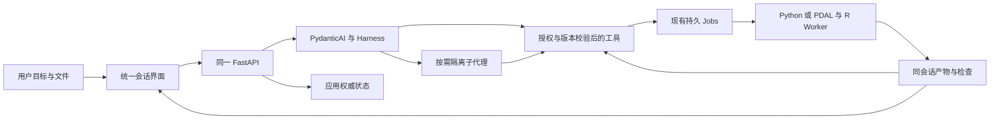

# ForestryUAV-Agent 独立项目审查与整改意见

审查日期：2026-10-13。审查方式：用户明确要求的一名独立子代理只读审查。审查基线为用户最新意图、工作区 AGENTS.md、原项目书、v2 修订书及当前交付记录，优先级以用户能完成的操作衡量。

修复后状态另见 [审查整改记录](REVIEW-FIXES-20261013-zh.md)。本文保留修复前事实，不覆盖后续交付。

本次仅新增这份报告。没有修改业务源码、配置、数据库或历史证据，没有运行测试、模型、科学计算，没有安装、下载或重启服务。主代理取得的一次当前 `/runtime` 只读观察作为运行证据复用。

## 1. 总体结论

项目已有真实通用 Agent、受限执行、持久作业、来源与产物、知识/显式记忆、按需子代理，以及实算的点云科学阶段。不能把它评价为只有界面或完全没有 Agent。

但当前日常产品仍沿用阶段1的开发者验收工作台：修订、权限分类、调用计数、人工验收、封存和审计原则大量进入主界面。用户需要了解内部契约，才能完成本应自然的“选择文件 → 提出目标 → 查看结果 → 继续追问”。这是产品抽象与工程机制之间的边界没有做好。

更深的缺口有三个：

1. **会话与一次交付任务绑定为同一生命周期。** 每个普通回答都进入待用户验收状态并显示提示；此时仍可补充消息，但用户显式封存后同一会话不能继续发送。
2. **联网搜索暂缓没有完整落到运行时。** 文档说暂缓，但搜索/网页工具、角色权限、默认提供商和部分探测路径仍存在；隐藏文字不能代替实际关闭工具。
3. **科学阶段之间仍需要人工登记上游产物和修订输入。** 已有科学工具实际运行，不等于 Agent 能从用户提供的一份 LAS 自主连续完成全部处理。

同时，一键入口当前复用的8769主后端尚未加载新增的点云源码，也没有配置科学镜像。磁盘上有实现、独立工作区已有科学产物、用户打开的工作台是否能调用，是三个不同事实。

建议保留已验证执行底座，先完成日常会话、文件输入、运行能力与领域阶段衔接。继续堆叠开关、Schema、实验数量，不能解决这些问题。没有发现需要据此推倒整个项目或另建 Agent 框架的证据。

## 2. 审查范围与证据边界

覆盖产品交互、模型与工具编排、角色与权限、资源/产物/持久化、部署身份与恢复、通用/领域完成边界、科学结果有效性、测试节奏及文档治理。采用范围检索和关键实现阅读，没有遍历庞大的历史工作区或逐项重验已有结果。

关键依据：

| 依据 | 审查用途 |
|---|---|
| [用户确认的开发节奏](C:/Users/yzh/WorkBuddy/Agent/AGENTS.md:3) | 冻结已验证行为、测试触发、搜索暂缓与唯一交付入口。 |
| [原书的结构原则](C:/Users/yzh/WorkBuddy/Agent/forestry-uav-agent-project-book-zh.md:104) | 不机械建立目录/接口层；只实现真实纵向流程所需职责。 |
| [原书模型与 harness 实验](C:/Users/yzh/WorkBuddy/Agent/forestry-uav-agent-project-book-zh.md:850) | H0/H1/H2 的研究用途，不能据此要求普通用户先选择工作类型。 |
| [v2 实际完成边界](C:/Users/yzh/WorkBuddy/Agent/forestry-uav-agent-project-book-zh-v2.md:113) | 实算工具链、未完成自主领域链与规模边界。 |
| [当前交付入口](C:/Users/yzh/WorkBuddy/Agent/forestry-uav-agent-v1/docs/DELIVERY-TRACKER.md:1) | 现有可用操作与阶段2/3剩余交付。 |
| [阶段1出口裁决](C:/Users/yzh/WorkBuddy/Agent/forestry-uav-agent-v1/docs/STAGE-1-EXIT-zh.md:3) | 通用功能出口已收口，不能改判为所有任务稳定成功或完整V1通过。 |
| [会话界面整理交付](C:/Users/yzh/WorkBuddy/Agent/forestry-uav-agent-v1/docs/SESSION-UI-DELIVERY-20261013.md:5) | 来源展示已按当前会话过滤，现有后端关系保持。 |
| [当前主后端观察](C:/Users/yzh/WorkBuddy/Agent/forestry-uav-agent-v1/workspace/evidence/project-review-runtime-20261013.json:1) | 主代理一次只读运行身份观察；本子代理读取原记录，没有重复请求。 |

结论用语分为“源码确认”“现有记录证明”“静态风险”“尚未确认”。审查不提供新增运行通过率、性能数字、科学准确率或冷启动验收。未提交 ROI 实现按开发代码评价，不计可用交付。

## 3. 用户点名元素：建议如何处理

| 当前元素 | 当前意义 | 日常界面整改意见 | 应保留的内部机制 |
|---|---|---|---|
| 修订1、修订2 | 绑定输入/目标/权限版本，防止旧结果冒充当前结果。 | 从目标摘要删除，版本详情放文件历史或诊断。添加附件/补充目标使用自然操作，不要求用户“保存规范修订”。 | 版本冲突、旧作业结果隔离、来源与方法血缘。 |
| 右侧“交付原则”卡 | 持续解释审计、只读、权限、验收原则。 | 删除常驻卡。规则由程序执行；帮助内容放按需说明。 | 只读源、真实结果、可追溯动作。 |
| “目标、消息和输入均为公开信息” | 改变外发审批及允许读取的私密资源。 | 当前删除。所有用户输入默认按受保护数据处理；当前搜索暂缓，不要求用户分类任务。 | 来源分类可在内部保留；未来真实外发时呈现具体授权。 |
| “文件已检查，任务语义待验收” | 普通模型回合完成后，统一进入人工验收。 | 删除固定阻塞提示，并修正生命周期。普通回复正常结束，输入框可继续使用；实际检查失败或必需信息缺失才提示。 | 文件完整性/格式/目标所需结果的真实检查；科学局限明确。 |
| “本地执行与存储”、LOCAL ONLY、私密上下文标签 | 描述部署位置与外发策略。 | 从每屏重复提示删除；安装/设置中说明数据存放位置即可。 | 会话与产物持久保存、备份与隔离，不因用户上传而取消。 |
| 搜索尚待验收、搜索审批、搜索能力勾选、搜索状态 | 来自历史开发和搜索原始范围。 | 当前不展示、不开放搜索调用、不发搜索探测。历史记录可保留在相应会话的诊断中。 | 将来需要时恢复已有边界；公开依赖获取与搜索分别管理。 |
| 模型请求数、token、动作次数、所有委派/计划/作业页签 | 开发诊断与评估观察。 | 默认折叠到“执行详情”；正在运行的必要进度保留，用户不需要用次数判断结果。 | 预算、运行日志、恢复和评估账本。 |
| 产物“校验和已检查”、SHA256 | 证明文件身份及完整性。 | 默认展示文件名、类型、可读结果与下载；哈希和验证详情按需查看。 | 必需产品、校验、版本一致与篡改检查。 |
| 暂停/恢复/取消政策长段落 | 提醒操作与 Worker 停止的区别。 | 操作生效时给简短真实状态，不持续占据侧栏。长说明放帮助。 | 暂停/取消真实执行语义及停止确认。 |

源码位置：[目标摘要](C:/Users/yzh/WorkBuddy/Agent/forestry-uav-agent-v1/frontend/src/App.tsx:267)、[公开信息选项](C:/Users/yzh/WorkBuddy/Agent/forestry-uav-agent-v1/frontend/src/App.tsx:297)、[本地提示](C:/Users/yzh/WorkBuddy/Agent/forestry-uav-agent-v1/frontend/src/App.tsx:246)、[右侧页签与原则卡](C:/Users/yzh/WorkBuddy/Agent/forestry-uav-agent-v1/frontend/src/App.tsx:313)、[固定验收阻塞](C:/Users/yzh/WorkBuddy/Agent/forestry-uav-agent-v1/src/forestry_agent/agent.py:1215)。

**“本地存储提示没有必要”与“持久存储没有必要”必须分开。** 用户提供数据后仍需要找回会话、文件、报告和未完成作业。可以删除主界面的口号，不能删除历史与恢复。也不能把当前路径登记称为已经支持上传。

## 4. 按优先级排列的发现

本报告没有提出P0问题：没有本次新发现的实际数据丢失、未经授权外发或已证实错误科学产品发布记录。P1是阻碍用户目标或与明确产品范围不一致的实际问题；P2是范围、结果选择或维护上的具体风险；P3是后续可收口的复杂度。

### F01 / P1：普通回答被人工验收流程包围，会话封存后不能继续

**证据与事实。** `Answer.artifact_ids`默认可以为空。普通回合没有未决作业、委派或审批时，`finish`仍统一写入`waiting_user`和“文件已检查，任务语义待验收”。`Delivery.candidate`将语义检查定义为等待用户证明；接受后封存、状态改为completed。前端禁用completed会话发送，后端也拒绝修改所有终态任务。

证据：[Answer允许无文件](C:/Users/yzh/WorkBuddy/Agent/forestry-uav-agent-v1/src/forestry_agent/agent.py:73)、[统一等待验收](C:/Users/yzh/WorkBuddy/Agent/forestry-uav-agent-v1/src/forestry_agent/agent.py:1215)、[语义检查由用户证明](C:/Users/yzh/WorkBuddy/Agent/forestry-uav-agent-v1/src/forestry_agent/delivery.py:51)、[封存转completed](C:/Users/yzh/WorkBuddy/Agent/forestry-uav-agent-v1/src/forestry_agent/delivery.py:126)、[发送禁用](C:/Users/yzh/WorkBuddy/Agent/forestry-uav-agent-v1/frontend/src/App.tsx:309)、[后端终态禁止修改](C:/Users/yzh/WorkBuddy/Agent/forestry-uav-agent-v1/src/forestry_agent/store.py:200)。

**影响。** 解释性问题、一般文件处理、正式科学交付都出现同样的人工验收语义，即使普通问答没有生成文件，也显示“文件已检查”。`waiting_user`仍允许补充消息，并非每次回答后输入框立即失效；但用户按提示显式封存后，同一会话的追问被前后端阻止。只隐藏提示不能修复这种状态与产品行为的混淆。

**推荐改法。** 在产品行为上区分会话与一次运行/交付的状态，优先沿用现有持久结构，不预设必须新建Conversation表。普通回答和成功文件处理正常结束本回合，保留会话继续能力；只有实际外部授权、必需澄清、明确要求的正式交付确认才等待用户。保留正式交付清单及其不可变版本，后续追问产生新的回合/结果，不改写已封存产品。不要为此另外引入聊天服务或第二个 Agent 循环。

**验收行为。** 简单问答后直接追问；生成文件后可继续修改；正式保存一份交付后仍可询问它；只有真实缺信息/权限时出现明确待用户动作。确认按钮不再是每次回复的必经步骤。

### F02 / P1：搜索暂缓停留在文档层，工具开放和探测未统一关闭

**证据与事实。** Config默认搜索提供商为百度，没有启用/暂缓字段；创建Task保存搜索配置。协调角色仍有web.search/web.read。`prepare_tools`会依据任务权限、角色、科学镜像和H0过滤工具，但没有搜索暂缓过滤。search_web/read_web_page仍注册。公开任务在Network.admit直接走无需逐项审批分支。doctor默认`probe_search=True`，会以OpenDroneMap检索探测；UI环境探测明确调用`probe_search=False`，这条路径没有探测搜索，不能误说所有打开设置都会联网。

证据：[默认搜索配置](C:/Users/yzh/WorkBuddy/Agent/forestry-uav-agent-v1/src/forestry_agent/config.py:29)、[Task冻结搜索配置](C:/Users/yzh/WorkBuddy/Agent/forestry-uav-agent-v1/src/forestry_agent/app.py:274)、[角色工具范围](C:/Users/yzh/WorkBuddy/Agent/forestry-uav-agent-v1/src/forestry_agent/roles.yaml:6)、[实际工具过滤](C:/Users/yzh/WorkBuddy/Agent/forestry-uav-agent-v1/src/forestry_agent/agent.py:442)、[搜索/网页工具注册](C:/Users/yzh/WorkBuddy/Agent/forestry-uav-agent-v1/src/forestry_agent/agent.py:1083)、[公开任务路径](C:/Users/yzh/WorkBuddy/Agent/forestry-uav-agent-v1/src/forestry_agent/network.py:409)、[doctor默认探测](C:/Users/yzh/WorkBuddy/Agent/forestry-uav-agent-v1/src/forestry_agent/doctor.py:19)、[设置探测关闭搜索](C:/Users/yzh/WorkBuddy/Agent/forestry-uav-agent-v1/src/forestry_agent/app.py:124)。

**影响。** 当前用户明确不要搜索流程，却可能仍遇到搜索调用建议或审批；公开选项还实际改变权限。不能以“尚未正式开发验收”解释为“代码完全不存在”，也不能以历史网页夹具通过证明当前范围已获用户恢复授权。本次没有执行网络请求，不判断当前提供商能否成功返回。

**推荐改法。** 当前发布配置统一禁用搜索和网页读取，在工具暴露与执行边界都拒绝；诊断跳过搜索。普通界面移除公开上下文开关、搜索文案和搜索设置。历史搜索/审批记录保持在原会话。已验证的公开依赖准备与应用安装需要分别管理，不因为关闭搜索而破坏代码环境或本机模型请求。

**验收行为。** 新会话工具列表无搜索/网页工具，模型无法通过旧接口发起它们；环境打开/启动不做搜索探测。历史会话查看不丢失原记录。验证只针对新增门禁与相关界面，不运行真实搜索。

### F03 / P1：用户文件入口实际上要求手工路径和输入修订

**证据与事实。** 当前界面让用户输入绝对文件/目录路径，再点击“登记只读资源”。后端register仅解析路径并写资源引用，没有接收文件字节的上传过程。新增文件到已有会话会打开目标/输入修订表单；修订后暂停，需要显式恢复。目录可以浏览，但代码作业仅接受逐个登记的单文件，目录授权不能直接执行。新增附件和内部授权协议混在一起。

证据：[数据源表单](C:/Users/yzh/WorkBuddy/Agent/forestry-uav-agent-v1/frontend/src/App.tsx:358)、[添加来源后打开修订](C:/Users/yzh/WorkBuddy/Agent/forestry-uav-agent-v1/frontend/src/App.tsx:182)、[路径登记实现](C:/Users/yzh/WorkBuddy/Agent/forestry-uav-agent-v1/src/forestry_agent/resources.py:43)、[仅单文件Job输入](C:/Users/yzh/WorkBuddy/Agent/forestry-uav-agent-v1/src/forestry_agent/jobs.py:180)、[修订后暂停](C:/Users/yzh/WorkBuddy/Agent/forestry-uav-agent-v1/src/forestry_agent/app.py:372)、[目录中登记单文件按钮](C:/Users/yzh/WorkBuddy/Agent/forestry-uav-agent-v1/frontend/src/SourceBrowser.tsx:94)。

**影响。** 用户认为已上传数据，实际却在操作路径授权、Resource ID、修订与恢复。数据准备耗时转移给用户；航片目录和多阶段点云流程会尤其繁琐。

**推荐改法。** 给用户统一的“添加文件/文件夹”体验。小文件提供浏览器选择或拖拽并落入当前会话；大LAS/航片目录使用可信本机选择器/窄范围路径引用，避免百GB文件全量浏览器复制。后端沿用只读授权及版本检查。当前无活跃运行时附件直接关联当前会话；活跃运行中添加新输入时，只说明是否需要暂停/从下一回合使用，内部保存必要版本，不暴露“规范修订”协议。

**验收行为。** 不懂路径或Resource ID的用户能添加一个文档并让Agent读取；能选择多个文件或目录；已有会话补充文件后继续；文件名、数量和实际来源清晰。大文件引用保持原字节与只读，不复制整个数据体到浏览器或数据库。

### F04 / P1：领域阶段不能直接消费上游产物，完整自主链尚未接通

**证据与事实。** 冠层的chm/seeds/instances阶段要求精确角色到resource_id映射，每个ID必须通过Resources.resolve(task_id)并已属于Task输入。Jobs的input_artifact_ids仅允许依赖准备作业。原生Agent有产物检查/读回工具，没有资源登记或输入修订工具；其科学提示甚至明确要求“登记并修订输入”。领域说明要求操作者将上级文件重新登记并保存输入修订。ROI开发代码沿用相同限制。

证据：[冠层输入角色与resolve](C:/Users/yzh/WorkBuddy/Agent/forestry-uav-agent-v1/src/forestry_agent/lidar_canopy.py:23)、[Artifact挂载仅限依赖](C:/Users/yzh/WorkBuddy/Agent/forestry-uav-agent-v1/src/forestry_agent/jobs.py:187)、[Agent文件工具](C:/Users/yzh/WorkBuddy/Agent/forestry-uav-agent-v1/src/forestry_agent/agent.py:806)、[科学提示要求人工衔接](C:/Users/yzh/WorkBuddy/Agent/forestry-uav-agent-v1/src/forestry_agent/agent.py:607)、[实际操作要求](C:/Users/yzh/WorkBuddy/Agent/forestry-uav-agent-v1/docs/LIDAR-CANOPY-zh.md:21)、[ROI同类resolve](C:/Users/yzh/WorkBuddy/Agent/forestry-uav-agent-v1/src/forestry_agent/lidar_roi.py:68)。

**影响。** 模型能选择一个领域工具，但无法在同一授权目标下从地形输出连续走到冠层/实例/ROI。当前实算是操作者驱动的阶段工具链，不能记为完整领域Agent流程。

**推荐改法。** 在现有Jobs/Resources上支持有范围的同任务ArtifactRef作为下阶段输入：绑定产物生产者、源/方法/科学镜像、哈希和所需角色；保留来源不可变与角色权限交集。无需给模型任意宿主路径登记权限，也无需每个阶段扩充用户原始输入授权。配方与依赖图由Agent/确定性校验共同管理，已成功阶段复用，用户仅补真正缺少的原始文件或声明。

**验收行为。** 用户一次选择原始LAS和必要声明，提出地形/冠层目标，Agent可自主串起允许阶段并交付文件；无需用户搬文件、填JSON、登记每个中间产品。接入验证优先复用已有科学产物，科学计算本身不因接口调整重跑。

### F05 / P1：一键入口打开的主Agent与磁盘领域实现不是同一能力版本

**证据与事实。** 本次复用的运行观察显示8769主服务启动源摘要为`fc54ecd8f32cdafae2b0c07d48b191c0bb490131b99253ef0812a6a702d145e7`；就查询的cloud_inputs.py、lidar_terrain.py、lidar_canopy.py、lidar_roi.py四文件而言，启动清单没有，磁盘存在；主配置science_image为空。静态前端已更新。这里的空清单只针对上述四文件，不表示旧服务没有任何其他领域相关记录。启动器发现源码差异后仅提示手动重启，继续复用现有服务。这避免破坏旧任务，但尚未完成用户产品升级。

证据：[一次当前运行观察](C:/Users/yzh/WorkBuddy/Agent/forestry-uav-agent-v1/workspace/evidence/project-review-runtime-20261013.json:1)、[启动器源码差异仅提示](C:/Users/yzh/WorkBuddy/Agent/forestry-uav-agent-v1/scripts/launch_agent.py:253)、[一键入口的已验范围](C:/Users/yzh/WorkBuddy/Agent/forestry-uav-agent-v1/docs/ONE-CLICK-START-DELIVERY-20261013.md:22)、[主界面发布记录](C:/Users/yzh/WorkBuddy/Agent/forestry-uav-agent-v1/docs/SESSION-UI-DELIVERY-20261013.md:25)。

**影响。** “已写好/独立演示通过”容易被用户理解为一键入口中的当前Agent已经能用；最新UI可能给旧后端展示不适用能力。

**推荐改法。** 完成一次有记录的产品部署收口：确认原作业/暂停状态，保留原工作区，部署兼容的后端与静态UI，明确新会话的科学能力配置，不给历史Task静默增加权限。应用向UI提供当前进程实际能力与版本摘要；UI按实际能力渲染。日常启动复用正确版本，升级是单独的受控操作，不能每次点击启动都强制重启。

**验收行为。** 同一入口打开的当前后端确实具备声明的接口；旧会话和已成功作业不丢失、不重跑；新增会话能看到实际可用领域能力。只验部署/版本衔接，不重新验整个基础体系。

### F06 / P1：主界面持续展示研究/审计术语，实际结果和用户决策反而不突出

**证据与事实。** 用户点名元素均在当前App中，且不是只有一个位置：本地/只读/受控外发、修订、公开分类、检查与验收、动作次数、封存原则同时出现。空状态仍提示搜索/代码/林业“逐阶段验收”；它与已冻结通用代码功能出口也不同步。

证据：[本地和身份标签](C:/Users/yzh/WorkBuddy/Agent/forestry-uav-agent-v1/frontend/src/App.tsx:243)、[空状态与任务摘要](C:/Users/yzh/WorkBuddy/Agent/forestry-uav-agent-v1/frontend/src/App.tsx:260)、[常驻原则与政策说明](C:/Users/yzh/WorkBuddy/Agent/forestry-uav-agent-v1/frontend/src/App.tsx:328)、[设置仍有公开搜索](C:/Users/yzh/WorkBuddy/Agent/forestry-uav-agent-v1/frontend/src/App.tsx:374)。

**推荐改法。** 默认结构收口为历史会话、对话/输入、当前附件、产物及必要运行状态。执行记录/计划/委派/预算折叠；模型与既有高级开关继续留设置，符合前一轮用户要求。H0/H1/H2可保留评估接口，日常默认统一完整Agent。按第3节处理表删除冗余，不换成另一批“安全/可靠/真实”口号。

**验收行为。** 空会话能直接输入和添加文件；用户无需判断公开性、工具分类、修订或验收层级；结果页优先呈现可读文件和具体缺项。必要的科学局限仍围绕实际产品展示，避免删除“无真值/不可用”等会改变解释的事实。

### F07 / P2：会话来源展示已隔离，但底层仍是全局授权登记表

**证据与事实。** 最新UI使用active.input_refs/selected过滤sessionResources，已消除新会话全局CSV展示。后端resources表仍没有会话归属字段，`/resources`返回所有登记，register每次不同请求创建新ID。Task通过input_refs限制模型读取；产物有task_id并按任务目录保存。因此“当前所有文件会串到其他任务”不是事实，但“记录已经物理搬到每个会话的上传区”同样不准确。

证据：[前端当前会话过滤](C:/Users/yzh/WorkBuddy/Agent/forestry-uav-agent-v1/frontend/src/App.tsx:94)、[全局资源返回](C:/Users/yzh/WorkBuddy/Agent/forestry-uav-agent-v1/src/forestry_agent/app.py:151)、[登记与全局表](C:/Users/yzh/WorkBuddy/Agent/forestry-uav-agent-v1/src/forestry_agent/resources.py:55)、[模型Task输入校验](C:/Users/yzh/WorkBuddy/Agent/forestry-uav-agent-v1/src/forestry_agent/resources.py:79)、[产物Task归属](C:/Users/yzh/WorkBuddy/Agent/forestry-uav-agent-v1/src/forestry_agent/resources.py:164)、[已交付展示范围](C:/Users/yzh/WorkBuddy/Agent/forestry-uav-agent-v1/docs/SESSION-UI-DELIVERY-20261013.md:17)。

**推荐改法。** 保留底层可复用资源引用，把当前会话附件关联作为API的正式查询/添加/移除入口；确需重复使用文件时用户主动从原会话添加。上传文件按会话存放，外部大文件保留引用，产物与原始输入明确区分。移除附件只撤销该会话未来读取范围，不删除用户原文件或改写历史证据。引入适度归档/清理策略，不能清除CSV掩盖旧实验。

**验收行为。** 新会话无历史附件；切换/刷新只见所属来源与产物；移除附件后不能被新执行继续读取；原会话历史仍能说明曾使用什么。后台全局登记用于内部索引，不再次铺到聊天输入区。

### F08 / P2：领域结果页按文件名分别选“最后一个”，可能混用不同版本产品

**证据与事实。** LidarPanel的`file(name)`从Task全部产物中按同名取最后项，质量、树表、预览及下载各自选择，没有绑定同一交付或生产阶段集合。Task修订保留旧产物是正确的，但结果页没有以同一候选manifest/血缘集区分当前与历史。这是源码确认的选择风险，本次没有构造或运行混版案例。

证据：[按名称独立选最后产物](C:/Users/yzh/WorkBuddy/Agent/forestry-uav-agent-v1/frontend/src/LidarPanel.tsx:18)、[独立读质量与树表](C:/Users/yzh/WorkBuddy/Agent/forestry-uav-agent-v1/frontend/src/LidarPanel.tsx:28)、[Task产物列表](C:/Users/yzh/WorkBuddy/Agent/forestry-uav-agent-v1/src/forestry_agent/app.py:486)。

**推荐改法。** 结果页使用一个明确产品集合/manifest的Artifact IDs、源/方法/版本，不按文件名拼接；显示当前可用结果与历史版本。修订号仍可藏在详情中，但版本约束必须继续执行。

**验收行为。** 同一预览、指标、质量和下载属于同一集合；新的部分后处理不会配上旧版树表；旧结果可查看但不会被当成当前目标的完整交付。可复用已有产物记录验证选择，不重算CHM/实例。

### F09 / P2：就绪状态与能力说明尚未形成同一真实来源

**证据与事实。** `/health`把domain固定为not_implemented；doctor同样固定domain状态，且general_prerequisites_ready把搜索也作为缺项，UI又显示“权重可用·协议待验收”。这些分别是进程健康、即时探测、冻结行为证明，意义不同；现有UI没有清楚整合它们。科学配置存在也不等于该机器/该Task实际支持。

证据：[health固定领域状态](C:/Users/yzh/WorkBuddy/Agent/forestry-uav-agent-v1/src/forestry_agent/app.py:112)、[doctor固定状态与搜索前提](C:/Users/yzh/WorkBuddy/Agent/forestry-uav-agent-v1/src/forestry_agent/doctor.py:71)、[设置状态呈现](C:/Users/yzh/WorkBuddy/Agent/forestry-uav-agent-v1/frontend/src/App.tsx:373)、[已冻结功能出口](C:/Users/yzh/WorkBuddy/Agent/forestry-uav-agent-v1/docs/STAGE-1-EXIT-zh.md:12)。

**推荐改法。** 用现有配置、运行身份和实际环境结果生成按能力的可用/缺前提/暂缓状态；进程健康不替代科学能力探测，短探测不把已经存在的行为证明抹成“没验收”。无需每次打开设置运行模型试验。搜索暂缓不成为通用启动缺项。

**验收行为。** 当前Agent能做什么、缺什么由当前运行条件决定；已冻结记录只说明已证明范围。用户不再因doctor的not_probed误认为必须继续搜索测试才能使用文件/代码。

### F10 / P2：整体源码身份漏掉实际执行的R脚本

**证据与事实。** source_manifest仅计入.py/.yaml/.html/.js/.css，未包含.R。冠层与ROI准备函数读.R内容并嵌入生成代码，Jobs保存完整code及code_sha256。故实际单Job代码证据仍包含R，不能说科学执行完全没有溯源；缺口是部署/评估的整体源码摘要不能发现仅R修改。

证据：[源码清单后缀过滤](C:/Users/yzh/WorkBuddy/Agent/forestry-uav-agent-v1/src/forestry_agent/provenance.py:11)、[冠层嵌入R](C:/Users/yzh/WorkBuddy/Agent/forestry-uav-agent-v1/src/forestry_agent/lidar_canopy.py:62)、[ROI嵌入R](C:/Users/yzh/WorkBuddy/Agent/forestry-uav-agent-v1/src/forestry_agent/lidar_roi.py:87)、[Job代码与摘要](C:/Users/yzh/WorkBuddy/Agent/forestry-uav-agent-v1/src/forestry_agent/jobs.py:234)。

**推荐改法。** 清单包括实际执行配方和脚本，明确应用/UI/科学配方身份；保持旧清单解释和旧Job证据，不覆盖历史摘要。身份修复不导致已有正确科学产品重算。

**验收行为。** 仅变更R或方法配方也能改变相应身份，旧结果仍绑定原生产代码与镜像。验证用静态身份变化和已有Job记录即可，不运行科学计算。

### F11 / P2：工具选择自主性已有，但操作规程和失败恢复仍偏重协议补救

**证据与事实。** H2使用原生SubAgents，角色按需选择并带隔离、权限、预算；并没有固定让所有角色按部门顺序运行。默认Task和新UI都采用H2/完整范围。这些是真实Agent机制。另一方面，指令持续注入大量ID/窗口/锁/审批/来源构建细节；依赖和文件工具的参数/回执使模型承担许多应由工具完成的确定性衔接。历史记录存在协议纠错和人工补充后才成功；功能出口明确不承诺首次成功率。

证据：[默认H2](C:/Users/yzh/WorkBuddy/Agent/forestry-uav-agent-v1/src/forestry_agent/contracts.py:55)、[原生SubAgents按需注册](C:/Users/yzh/WorkBuddy/Agent/forestry-uav-agent-v1/src/forestry_agent/agent.py:590)、[角色自主目标](C:/Users/yzh/WorkBuddy/Agent/forestry-uav-agent-v1/src/forestry_agent/roles.yaml:4)、[详细过程指令](C:/Users/yzh/WorkBuddy/Agent/forestry-uav-agent-v1/src/forestry_agent/agent.py:759)、[原完整评分与范围](C:/Users/yzh/WorkBuddy/Agent/forestry-uav-agent-v1/docs/STAGE-1-EXIT-zh.md:18)。

**推荐改法。** 固定“统一Agent按需选择工具”的产品默认。对实际阻塞，优先把确定性参数衔接、输入角色解析、产物复用、状态对账放进现有工具，降低模型协议负担。用户只补目标、缺失数据或必要授权，不充当模型调用协议修复员。不要用不断追加提示和更多同输入试次替代工具改进。

**验收行为。** 多步文件/科学任务不要求用户选择通用/专业或手工委派；任务失败给出具体可恢复动作并复用已有结果。正式成功率比较留阶段3，不在本次审查或界面整理时重新运行。

### F12 / P3：底座无需重建，后续结构与记录治理应控制增量复杂度

**证据与事实。** 当前依赖是PydanticAI及Harness；模型循环、检查点、规划、压缩和SubAgents复用原生机制，应用保存权威Task/动作/Jobs。没有同时运行一套LangGraph循环的证据。两个SQLite用途不同，不能因为数量就认定重复持久化。`source_build_legacy.py`用于核对历史Job身份，活跃环境代码显式导入其历史重建器，也不能直接当废文件删除。

证据：[实际框架依赖](C:/Users/yzh/WorkBuddy/Agent/forestry-uav-agent-v1/pyproject.toml:10)、[原生检查点与应用Jobs](C:/Users/yzh/WorkBuddy/Agent/forestry-uav-agent-v1/src/forestry_agent/agent.py:90)、[v2框架修订](C:/Users/yzh/WorkBuddy/Agent/forestry-uav-agent-project-book-zh-v2.md:170)、[历史源码用途](C:/Users/yzh/WorkBuddy/Agent/forestry-uav-agent-v1/src/forestry_agent/source_build_legacy.py:1)、[历史重建器实际引用](C:/Users/yzh/WorkBuddy/Agent/forestry-uav-agent-v1/src/forestry_agent/environments.py:18)。

**推荐改法。** 保留当前框架与稳定行为边界；新增真实流程时按依赖/复杂度拆函数或模块，不新增service/repository/factory层，不开发通用插件平台。保留历史兼容代码明确用途。当前交付表是执行入口，长STATUS/历史实验只追溯，不复制成下一轮执行队列。

**验收行为。** 每项新抽象有实际调用方和具体简化效果；一条任务链只有一个权威状态、执行器和预算来源。无关整理不触发底座回归或科学重算。

## 5. 技术方案与框架评价

现有技术路线可以继续使用：React/TypeScript负责日常交互；FastAPI提供同一API；PydanticAI/Harness负责模型工具循环及按需子代理；应用SQLite记录授权、Task、动作、Job和产物；Docker/WSL运行通用Python及固定PDAL/R/lidR科学环境。LLM负责理解、计划与解释，真实计算交给固定科学工具。

值得保留的部分：源只读、宿主与容器隔离、任务范围、真实Job身份、错误与原失败保留、跨重启预算、可恢复状态、原始Z和未分配点语义。需要简化的是这些机制的操作入口与模型参数负担，而非其本身。

需要避免的过度定义：把每个逻辑契约做成新层；为UI命名另建一套服务；用户还没形成完整流程就添加评估开关/目录/无调用模块；为了修订原书而额外引入LangGraph；为Agent加入领域能力再创建独立专业Agent应用。领域方法约束、单位/支持/科学局限属于实质性语义，不能因为界面减负而删掉。

## 6. 功能与科学产品的真实完成边界

| 范围 | 已有证据支持 | 不能据此声称 |
|---|---|---|
| 通用Agent | 两本地模型实际工具任务；文件/代码/依赖/报告、知识/显式记忆、隔离角色、恢复/取消有冻结记录。 | 每类任务首次自主成功、稳定质量或所有环境都支持。 |
| 工作台 | 真实通用开发者UI；最新来源/产物按会话显示；一键打开服务。 | 产品交互已经简洁；真正文件上传已实现；当前主Agent具备新领域后端。 |
| 点云输入 | 真实UAV LAS离线事实/声明检查；LAZ头检查。 | 当前完整LAZ解压/处理已验收。 |
| PDAL/lidR | 真实地形/支持/HAG、CHM/种子/实例、LAZ/GPKG/表与中文报告；点/ID/原Z读回。 | 从自然语言完整自主交付；现场单木准确率；完整林木清查。 |
| ROI | 开发代码与接口存在。 | 已实算、已交付有效ROI流程。 |
| RGB/ODM | 目标方案和阶段计划存在。 | 原始航片重建与下游指标闭环已运行。 |
| 规模与发布 | 现有开发机器、小架次与配置限额有记录。 | ≥100GB、低配峰值/吞吐、干净安装和完整V1发布通过。 |
| 搜索 | 历史代码及一些网页/审批夹具记录存在。 | 当前用户已恢复搜索开发/开放要求，或当前搜索服务验收通过。 |

依据：[v2实算由操作者驱动且模型请求0](C:/Users/yzh/WorkBuddy/Agent/forestry-uav-agent-project-book-zh-v2.md:130)、[未交付范围](C:/Users/yzh/WorkBuddy/Agent/forestry-uav-agent-project-book-zh-v2.md:132)、[冠层partial及规模边界](C:/Users/yzh/WorkBuddy/Agent/forestry-uav-agent-v1/docs/LIDAR-CANOPY-zh.md:3)、[地形实际输入与内部检查](C:/Users/yzh/WorkBuddy/Agent/forestry-uav-agent-v1/docs/LIDAR-TERRAIN-zh.md:48)。

已有科学处理的保守解释是正确的：48个对象是方法定义的高冠层候选实例，有效分析面积来自采样与地形共同支持，不是自动完整样地清查；原始点和Z保留，treeID=0表示未分配。此类说明应放在相应产品结果/报告中。它们不像“本地存储”“交付原则”那样属于可整体删除的界面口号。

下一阶段需要完善方法/MetricSpec、ROI/缓冲分块/跨块身份和统一交付检查，尤其是支持分母、无支持不可用、方法限制、指标单位和产品一致性。没有真值时仍可交付有用但限定范围的产品；不得用用户点击确认或多个模型一致性代替科学准确性证据。

## 7. 重复测试和开发迟滞的根因

现有记录支持以下判断，而不是推测每一条测试都是浪费：

1. **旧失败被误认为缺覆盖。** 只读收口确认六组合首轮均已运行；此前拟补small/H0、small/H2的队列被撤销。[审计勘误](C:/Users/yzh/WorkBuddy/Agent/forestry-uav-agent-v1/docs/STAGE-1-AUDIT-20261012.md:9)。
2. **功能、模型质量、评估和产品出口混在一起。** 状态记录多次报告全部回归通过，开放模型任务仍失败，剩余总范围被反复列出；通过数量不能证明用户完整目标已交付。[历史全量回归与模型失败](C:/Users/yzh/WorkBuddy/Agent/forestry-uav-agent-v1/docs/STATUS.md:662)。这条记录是历史，不能被当作当前失败执行队列。
3. **试验工具与产品数据未从日常入口收口。** 默认沿用resolution-ui配置及开发工作区，历史Task/资源/产物留在主入口；最新前端只解决全局展示的一部分。[默认入口选择](C:/Users/yzh/WorkBuddy/Agent/forestry-uav-agent-v1/scripts/launch_agent.py:304)。
4. **模型协议缺陷促成多轮试次。** ID/工具Schema/构建范围/回执理解等问题不断变成提示和再次试验，而非尽早把确定性衔接交给工具。相关新增代码或具体失败可以触发局部验证，但不能据此恢复全部实验矩阵。
5. **产品链条没有作为完成单位。** 一个科学阶段、一个Schema或一份证据各自算进展，却仍缺输入到最终产物的自动连接。后续应以“用户现在能连续完成哪一步”报告。

用户最新冻结规则已经纠正许多问题。本报告不重新打开阶段1验收。后续每次验证先记录触发原因、受影响行为、可复用证据与停止条件；同输入/代码/配置不重建相同失败模型试次；正确结果先复用；报告问题只修报告；正式重复/配对/消融/留出集中阶段3。

建议每次交付记录只保留四项：新增可用操作、真实剩余阻碍、验证触发及复用范围、下一项交付。历史批次/脚本失败目录保留追溯，不以数量或覆盖分母推动无限追加实验。

## 8. 可执行整改顺序

| 顺序 | 交付单位 | 对应发现 | 完成表现 | 复用与停止条件 |
|---|---|---|---|---|
| A | 当前工作台减负与搜索关闭 | F02、F06 | 没有公开任务选项/搜索要素/原则口号；统一默认Agent；诊断折叠；运行时搜索不可用。 | 复用文件权限、预算、角色底座；仅验证删除的UI与新增门禁，达到行为即停止。 |
| B | 连续会话与正常文件输入 | F01、F03、F07 | 添加文件→发送→结果→追问/补文件可连续；一般回复无需人工验收，文件按会话查询。 | 复用当前Task/产物/来源记录；只验证会话/附件状态变化，保留已封存历史。 |
| C | 正确版本的一键主工作台 | F05、F09 | UI与后端能力匹配，当前新会话科学条件明确；旧任务不丢失、不重跑。 | 先对账原服务；一次部署收口，只验实际接口/身份/历史保持。 |
| D | 同任务产物到下一Job的领域流程 | F04、F08、F11 | 用户一次给LAS/声明→自主衔接地形/冠层→一致结果集合与中文报告。 | 先用已冻结产物接通ArtifactRef/选择逻辑；不得为接口改动重复地形/CHM计算。 |
| E | ROI、缓冲分块、科学包及RGB/ODM | 阶段2原剩余范围 | 满足真实目标的两条领域完整流程，支持/不可用/方法/质量真实；输出可下载和继续使用。 | 沿用固定运行时/现有Jobs；只计算尚未完成的阶段或改变配方所需部分。 |
| F | 统一发布与阶段3正式评估/规模 | 原WP-16 | 干净安装、低配/≥100GB、冻结比较与留出、可复现发布范围。 | 当前版本/数据/门槛冻结后集中运行；原失败与未运行分母保持。 |

A/B先解决当前用户每天遇到的阻碍；C/D把磁盘实现变成同一入口的真正可用流程；E/F继续原完整项目范围。不要以“UI简化已经完成”代替领域计划，也不要为了继续领域算法忽略日常会话根因。

## 9. 尚未确认的事项

- 本次没有复现实时模型选择、普通问答/追加附件或失联恢复，不新增“运行通过”结论；相关源码发现与原证据分开。
- 没有新增检索、下载或科学Job，不能判断当前搜索提供商健康、ODM可用、ROI结果正确、物理低配峰值或大数据吞吐。
- 一键入口的共享环境冷启动没有为审查关闭服务来验证；现有交付记录明确仅声明已核验范围。
- 新增科学/ROI代码与旧主后端之间的版本差异已确认，但本次没有进行部署升级。
- 对历史测试效率的判断依据已存在勘误与记录结构；没有把每条具体回归标为无效或追算耗时。

整改时应沿用上述边界：保留正确结果和历史证据，按具体行为解决产品问题，不把这份报告变成重新运行整个项目的测试清单。
# 后续状态

本文保留修复前的独立审查事实。用户已要求整改，实际修复、验证及仍未完成范围见 [修复记录](REVIEW-FIXES-20261013-zh.md)。不要将本文的历史缺陷状态当成当前版本能力。

