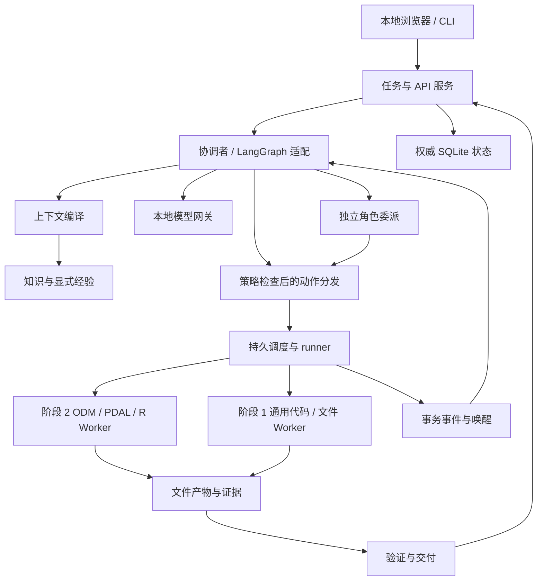

# ForestryUAV-Agent 开发实施项目书

项目标识：`forestry-uav-agent` · 独立版 1.1 · 2026-10-05

用途：向开发 Agent 提供足够的产品、接口、实现和验收信息，使其能够开展项目开发。本文是实施基线，英文版为主稿，中文版含义等同。开发以必需行为和验收证据为准；下文源码目录、模块/文件名和配置路径为示例，不是强制交付目录，也不表示代码已经存在。开发者选择满足需求的最简结构。

阅读路径：产品与基线（1–3）、接口与运行机制（4–8）、实际流水线（9）、界面与评估（10–12）、可执行工作包（13）、开发交接（14）。

- [1. 项目目标与完成定义](#section-1)
- [2. 范围、需求与发布清单](#section-2)
- [3. 技术基线、简洁结构与启动](#section-3)
- [4. 总体架构与模块接口](#section-4)
- [5. 数据契约、数据库与权威状态](#section-5)
- [6. 协调者、动作执行与长作业](#section-6)
- [7. 本地模型、上下文与角色配置](#section-7)
- [8. 通用能力、知识与执行边界](#section-8)
- [9. 林业领域实施方案](#section-9)
- [10. API、本地界面与交付契约](#section-10)
- [11. 测试方案与模型—harness 实验](#section-11)
- [12. 实施管理与风险解决](#section-12)
- [13. 实施工作包与V1验收](#section-13)
- [14. 开发 Agent 交接与首个任务](#section-14)
- [15. 项目依据与文档维护](#section-15)

<a id="section-1"></a>

## 1. 项目目标与完成定义

建设单人本地使用、具备林业无人机遥感专业能力的通用 Agent。非专业用户提供本地数据和自然语言目标后，应用选择有依据的方法、准备依赖、真实处理数据、管理长任务、验证产物，并交付文件及易读的中文报告。专业流程和参数选择由应用负责。

同一应用必须能够检索公开资料、阅读文档、操作文件、编写/调试/运行代码、安装有范围的依赖，以及对预设林业流水线之外的任务生成报告。语言模型负责控制和解释，地理空间与数值执行器负责产生测量结果。

阶段 1 先完成通用能力和可供开发者日常测试的较成熟 UI；验收通过后，阶段 2 才实施林业专业能力，阶段 3 做整体验证与实测规模。UI 属于第一阶段可用交付。

只有以下完整产品用户场景经过真实处理验证，项目才达到完成条件：

| 场景 | 输入与请求 | 必须可观察的结果 |
|---|---|---|
| U01 影像 | 原始无人机 RGB 航片文件夹；“拼接正射影像并估计林分覆盖” | 真实重建的正射影像、有明确含义且受数据支持的可见植被/冠层指标、支持区域/缺陷图层、方法与证据记录、报告 |
| U02 LiDAR | 无人机 LAS/LAZ；“生成地形/冠层高度并分割单木” | 有依据的 DTM/DSM/CHM、带实例标签的点云、单木/林分指标表、空间诊断与报告 |
| U03 通用工作 | 文档/文件与问题，或代码/数据处理目标 | 真实资料/文件/工具操作、适用的可执行代码和结果、证据及报告；无需套入林业模板 |
| U04 长任务恢复 | 应用重启中断了处理任务 | 对账存活 Worker，或恢复已登记的可重启阶段；无重复已提交产物；恢复后完成交付 |
| U05 缺少真值 | 没有独立现场基准的数据 | 有用的内部检查结果、有依据时的敏感性/局限、未知/不可用属性；不得编造精度百分比 |
| U06 方法约束 | U01/U02 加上明确指定方法 | 实际处理采用该方法，或准确说明不可行；不得静默替换 |
| U07 知识与记忆 | 导入私密专家资料，之后明确说“请记住” | 有本地来源的知识检索；仅针对明确请求写入经验，记录范围与证据 |
| U08 模型/harness 对比 | 冻结任务库、两个本地模型、三个 harness 变体 | 可复现试验清单、六组合比较、资源/成本结果及失败分析 |

<a id="section-2"></a>

## 2. 范围、需求与发布清单

### 2.1 具有约束力的需求

| ID | 需求及实施含义 |
|---|---|
| R01 | 必须真实重建原始航片；元数据读取或只接受已有正射影像的演示不能满足 U01。检查合格的已有派生产物可以复用。 |
| R02 | 必须真实处理 LiDAR，产生地形/高度/单木实例与指标；不能用文字报告替代计算。 |
| R03 | 通用工具和授权本地范围内的开放任务目标是一等能力。生成代码采用同样的执行与验证控制。 |
| R04 | 自主选择方法和参数，进行有界比较并依据证据选优。用户指定科学方法属于硬约束；适用专家知识可避免重复比较。 |
| R05 | 不假定现场真值存在。可用性、科学验证与任务验收分别表示；概率置信度需要统计或校准依据。 |
| R06 | 数百 GB 数据保留为文件，必须支持自适应分块、磁盘/RAM/VRAM 预留、阶段恢复及空间接缝检查。规模声明须经过实测。 |
| R07 | 角色定义长期保留，每个委派隔离上下文。串行模型执行仍保留隔离；并行方法试验受资源限制。 |
| R08 | 允许公开联网；私密数据/资料/派生私密内容保持本地，除非用户授权有范围外传。 |
| R09 | 导入知识和必要任务日志可以持久保存；学习得到的跨任务经验不得自动提升，必须有明确用户请求。 |
| R10 | 本地模型配置支持 Qwen3.8-27B 与 Qwen3.5-4B，后端、精度、上下文及路由可替换；不得自动转云端。 |
| R11 | 开发参考为用户指定的 5090 GPU、128 GB 内存、约 1 TB 可用磁盘。系统、显存及最终低配部署需探测/配置。 |
| R12 | 当前没有业务成本上限；技术动作/时间/无进展/空间限制仍可配置，且跨重启累计。 |
| R13 | 源数据默认只读；本地界面显示纠正/取消/暂停/恢复、缺失输入问题、证据说明及部分结果语义。 |
| R14 | 通用能力完成并验收后才开始领域实现；阶段 1 是可用通用测试产品，阶段 2 再加入林业能力。 |
| R15 | 不强制源码目录或为每个契约分层，按真实需求选择最简结构，复用成熟组件且避免重复抽象。 |
| R16 | 阶段 1 交付较成熟开发者 UI，支持真实执行、工具/文件/产物检查、模型配置、任务调整、诊断和恢复；占位 UI 不能通过。 |

### 2.2 发布边界

阶段 1 已交付可用通用测试产品；完整 V1 包含 U01–U07、两条真实流水线、通用代码/搜索工具、独立角色、持久作业、本地知识与显式记忆。受控 U08 评估及实测低配/规模配置属于 V1 发布证据。物种标签、兼容预训练模型、多光谱标定或可靠地面观测所支持的能力为条件能力；应用必须诊断前提，不能补造缺失信息。

首期不包含飞行规划、无人机控制、多用户云平台，也不承诺完整林下/物种清查；须提供未来领域和工具扩展接口。无需保留旧架构兼容性；现有代码只有通过可观察行为/契约检查后才可复用。

发布必须包含可安装应用、锁定环境/配置、生成的 API/DTO schema、方法/角色目录、夹具清单、自动契约测试、真实端到端交付包、评估结果、安装/用户/开发说明及局限清单。空模块、模拟最终产品和一组提示词都不构成发布。

<a id="section-3"></a>

## 3. 技术基线、简洁结构与启动

### 3.1 初始技术基线

| 范围 | 初始选择与必须完成的工作 |
|---|---|
| 应用 | Python 3.12、uv 应用锁，外部/持久化边界使用 Pydantic v2；应用包布局按实际需求决定 |
| Agent 执行 | 能减少实现工作时复用 LangGraph 持久执行，集成保持精简，权威任务状态归应用存储所有 |
| 本地服务 | FastAPI/uvicorn 绑定 `127.0.0.1`、SSE 进度；阶段 1 开发者 UI 按需复用成熟前端/组件方案，本地提供打包资源 |
| 元数据 | 本地存储 SQLite、WAL、外键、版本化迁移、事务和 compare-and-swap 更新 |
| 模型适配 | 初期配置采用一个经过验证的本地后端（Ollama 或 OpenAI-compatible），需要时再增加，在部署锁中固定实际模型/后端/模板 |
| 地理计算 | 通过经过测试的进程/容器适配器调用 ODM/NodeODM、GDAL/Rasterio、PDAL、lidR/R |
| 搜索 | 初期接通一个实际可用搜索连接器，复用现有提供商，SearXNG 或带密钥提供商作为部署选项 |
| 文档/知识 | 带锚点的文本/Markdown/HTML/PDF 提取、本地全文索引；语义索引和 OCR 为明确配置的可选后端 |
| 报告 | Jinja2 HTML 与 Markdown、JSON 清单；按产物类型导出 CSV/GPKG/GeoTIFF/LAS/LAZ |
| 测试 | pytest、受控执行器/模型夹具、故障注入、真实领域集成及独立规模/评估套件 |

上述是项目选型，不表示普遍最优。WP-01/WP-06 解析兼容包/工具版本并写入锁，然后按锁定版本开发；不能让最终用户选择 Python/R/工具。持久检查点能跨重启恢复，内存 saver 不能。([LangGraph 持久化](https://docs.langchain.com/oss/python/langgraph/persistence))

SQLite 元数据和 WAL 必须位于支持的本地文件系统，不放在共享网络文件系统。大数据可在检查访问和空间后使用挂载存储。短元数据写入串行管理，文件处理放在事务之外。([SQLite WAL](https://sqlite.org/wal.html))

### 3.2 根据已实现需求选择结构

没有必须交付的源码目录、应用包名，也不要求本文逻辑模块与文件/类一一对应。先检查已有代码，从小型应用、本地 UI 和针对结果的测试开始；只有实际代码规模、不同运行依赖或独立变更需要时才拆分文件/包。几个职责清楚的函数或模块可以实现多个契约，不需要建立空框架目录。

必须保留的是行为边界：模型推理与真实执行、源输入与尝试输出、用户授权与模型提案、任务记录与显式学习经验。它们可以共享进程、包或存储实现。不要为每个 DTO 增加 service/repository/factory/adapter 层，也不要在缺少具体需求时预建通用插件框架、消息中间件或分布式平台。长作业可能需要独立 Worker 进程，这不要求微服务化。

接口、Schema、存储及领域职责表是行为参考。只实现当前纵向闭环及其验收需要的部分，随下一个真实任务逐步扩展。阶段 1 不以前置实现林业 Schema、方法目录、算法或安装 GIS/R 为条件；领域结构在阶段 2 按需引入。

需要持久保存任务身份/状态、授权、副作用/作业恢复记录、环境/模型版本、证据和文件引用。委派/尝试输出隔离，大型输入保持文件化。数据库/表名及运行路径由开发者选择并写入配置；初期一个本地 SQLite 库加复用框架支持的检查点存储即可，只要约束与恢复可执行，逻辑记录可以合并存表。

下文 `src/forestry_agent`、`contracts/`、`D/`、`config/`、`docs/releases/` 等名称只用于示意职责落点。CLI/API 契约及文件格式语义仍有约束力，物理目录没有。所选包管理工具需要的锁文件遵守工具格式。安装说明记录实际采用的简洁目录和启动命令，不为匹配本文另建一套架构。

### 3.3 安装与命令契约

开发者实现并记录以下接口。依赖解析必须生成精确锁；大型 GIS/R/模型运行时采用独立锁定环境或容器摘要，不能塞进应用 Python 环境。

```bash
uv sync --locked --group dev
uv run --locked forestry-agent doctor --config config/app.local.yaml --output workspace/deployment.lock.json
uv run --locked forestry-agent serve --config config/app.local.yaml
uv run --locked forestry-agent run --request fixtures/general-demo-request.json
uv run --locked forestry-agent tasks inspect --task TASK_ID
uv run --locked forestry-agent evaluate --suite config/evaluation/reference.yaml
```

`resources register --path <local-path>` 登记用户选定只读资源并返回 ID，必要时先形成窄范围认证根授权。`doctor` 探测系统、路径、磁盘、CPU/RAM/GPU/VRAM、工具版本、模型服务清单、原生工具调用及必需环境；返回结构化逐能力支持/失败结果，写入解析锁，仅在必需前提不可用时返回非零。`serve` 提供 `/health`、界面和 API，计算后端缺失时不能假称领域就绪。`run` 与 API 使用同一服务，输出任务 id 和事件，并可连接已提交长任务。`evaluate` 记录独立试次，不能修改生产经验。开发工具定义在 `[dependency-groups].dev`；锁过时时 locked sync/run 必须失败，不能静默改变试验环境。([uv 锁定与同步](https://docs.astral.sh/uv/concepts/projects/sync/))

`doctor` 分开报告通用就绪状态和各可选/领域能力。阶段 1 安装只探测选定通用运行环境及本地模型；缺少 ODM/PDAL/lidR 不能阻止通用启动或 UI 测试，这些后端在阶段 2 再探测/安装。若采用前端构建工具，其依赖属于开发过程，普通本地启动使用打包 UI。

<a id="section-4"></a>

## 4. 总体架构与模块接口



协调者负责理解任务、规划、委派、对账和最终沟通；Worker 负责数值计算。子角色返回建议及引用证据，不能直接提交父任务状态。上下文编译不能授予文件/网络权限；工具和图检查点不能成为另一份任务事实源。

图和接口名描述逻辑职责，不要求对应数量的服务或类，能简洁实现时合并。阶段 1 使用通用代码/文件/文档 Worker 及通用验证/报告；林业规划器与 ODM/PDAL/R 分支在阶段 1 门槛后加入。

| 逻辑接口 | 类型化输入 → 输出 | 职责 |
|---|---|---|
| `TaskService.create/amend` | `TaskCreate/UserAmendment → TaskState` | 任务/应用层；创建不可变规范修订和验收契约 |
| `StateRepository.commit` | `StateCommit + expected_version → CommitResult` | 存储；原子 CAS 加记录/outbox |
| `ResourceService.register/resolve/stage/publish` | `ResourceRegistration/ResourceRef → ResourceRef/ResolvedResource` | 资源；检查根路径、版本、挂载与 attempt 所属写入 |
| `ModelGateway.generate/probe` | `ModelRequest/ModelProfile → ModelResponse/CompatibilityReport` | 模型；协议映射、流式返回、用量 |
| `ContextService.compile/compact` | `RunContextRequest → ContextManifest + message blocks` | 上下文；预算和溯源，不能提升事实 |
| `ExecutionService.submit/reconcile` | `ActionRequest → ExecutionReply/ReconciliationResult` | 执行；持久副作用意图与分发 |
| `JobManager.submit/query/cancel` | `JobSpec/job_id → JobHandle/JobState/CancelReceipt` | 执行；租约、进度、身份与恢复 |
| `DelegationService.delegate/resume` | `AssignmentSpec/assignment_id → AssignmentHandle` | 角色；独立命名空间和有界权限 |
| `DomainPlanner.plan` | `DatasetManifest + TaskSpec → ProcessingPlan` | 林业；可行性、配方、实验和产品依赖 |
| `VerificationService.verify/accept` | `target refs/TaskAcceptanceRequest → VerificationRecord/AcceptanceResult` | 验证；确定性检查与已声明局限 |
| `DeliveryService.build` | `task_id + candidate refs → DeliveryPackage` | 报告；真实文件、报告与清单 |

`ExecutionReply` 为判别联合，包含 `completed`、`job_submitted`、`approval_required`、`rejected`，并携带动作/attempt 引用。所有失败使用 `FailureRecord(code, stage, message, retryable, input_refs, effect_state, diagnostic_ref)`。错误码为有界枚举：`SCHEMA_INVALID`、`VERSION_CONFLICT`、`PERMISSION_DENIED`、`APPROVAL_REQUIRED`、`PRECONDITION_MISSING`、`MODEL_PROTOCOL_ERROR`、`RESOURCE_EXHAUSTED`、`EXECUTION_FAILED`、`RECONCILIATION_REQUIRED`、`VERIFICATION_FAILED`。同时保留易读解释和机器可处理区分。

<a id="section-5"></a>

## 5. 数据契约、数据库与权威状态

### 5.1 逻辑 Schema 规则

在实际外部/持久化边界使用类型模型，导出当前 API 使用的 Schema。下表是契约参考，不是首个 UI/工具闭环前必须建齐的文件清单。阶段 1 逐步实现通用记录；Method/Metric/林业 Experiment 记录及科学字段在阶段 2 增加。内部可以使用简单函数，语义一致时复用框架原生类型。记录 ID 为 UUID 字符串；方法/指标/能力等注册标识使用版本化稳定名称。时间为 UTC ISO-8601，规范/状态修订为正整数，单位显式，未知值为 null；集合默认值使用工厂。持久记录包含 `schema_version=1`、自身 id 和时间。控制边界拒绝多余字段；能力参数按该能力的版本化 schema 验证。Pydantic 支持类型模型及 schema 导出，科学正确性仍须单独检查。([Pydantic 模型](https://pydantic.dev/docs/validation/latest/concepts/models/))

表中字段默认必需，后缀 `?` 表示可选且默认为 null；列表/映射默认为空。记录之间引用使用稳定 ID，不能直接接受任意文件路径。

| 逻辑记录 | 必需载荷与类型 |
|---|---|
| `TaskCreate` | `request_id:str`、`objective:str`、`input_refs:list[str]`、`requested_metrics:list[str]`、`requested_method_id?:str`、`constraints:TaskConstraints`、`output_preferences:OutputPreferences` |
| `TaskSpec` | `task_id:str`、`revision:int`、创建载荷、`acceptance_id:str`、`budget_id:str`、`policy_snapshot_id:str`、`user_event_id:str` |
| `TaskState` | `task_id:str`、`state_version:int`、`spec_revision:int`、`status:TaskStatus`、`plan_id?:str`、活跃 run/assignment/job ID 列表、证据/产物 ID 列表、`acceptance_result_id?:str`、`blockers:list[Blocker]`、`cancellation_requested:bool` |
| `ResourceRef` | `resource_id:str`、`kind:ResourceKind`、`locator:str`、`version:str`、`fingerprint_kind:str`、`classification:public/private`、`owner_scope:str`、`read_only:bool`、`size_bytes?:int` |
| `DatasetManifest` | `manifest_id:str`、输入引用、模态/格式、数量/大小、`bounds?`、水平/垂直 CRS 和单位?、传感器/波段/回波/分类、采集组、分块/预览引用、质量观测和未知元数据 |
| `AgentRun` | `run_id`、task/role ID、`assignment_id?:str`、模型/harness 引用、状态、检查点命名空间/引用、已见状态版本、上下文清单引用、用量计数；根协调者没有父委派 |
| `PlanRecord` | id/修订/任务规范修订、`steps:list[PlanStep]`、依赖、候选/选定配方引用、有界依据、假设、被替代计划 id? |
| `ActionRequest` | action/task/run/logical-step ID、任务规范修订、能力 id/版本、schema 验证参数、输入版本、输出意图、方法/配方引用?、幂等键、策略/授权引用 |
| `ExecutionAttempt` | attempt/action ID、尝试序号、runner/环境身份、`effect_state`、开始/结束时间?、结果/失败引用?、对账状态 |
| `EvidenceRecord` | id、来源/版本、`kind:observation/assertion/inference/hypothesis`、主张/载荷引用、支持/反对引用、有效性、访问范围、被替代 id? |
| `ArtifactRecord` | id/资源引用、intermediate/deliverable 角色、staging/available/superseded/quarantined/deleted 生命周期、生成 attempt、输入/证据/检查引用、校验和 |
| `job.py:JobSpec/JobState` | id、父动作/规范修订、配方/环境引用、输入/输出引用、阶段依赖、分块、资源请求、恢复契约；状态、租约、runner 身份、进度/检查点/结果引用 |
| `role.py:AssignmentSpec/Result` | id、父任务/run/规范修订、角色、目标、输入、输出命名空间、权限交集、预算/完成契约；返回状态、摘要、证据/产物/作业引用、局限 |
| `verification.py` | `AcceptanceContract`：必备产品/指标/检查、允许不可用/部分结果；`VerificationRecord`：目标/版本、检查/版本、pass/fail/not_applicable/not_assessed、证据/局限；`AcceptanceResult`：契约/规范修订、accepted/accepted_with_limitations/partial/rejected、逐项结果/局限 |
| `ApprovalRecord` | id、用户事件、请求摘要、资源版本、副作用/数据/目的地范围、过期/撤销、单次/复用规则 |
| `ContextManifest` | id、实际模型输入引用、有序来源版本、token 计数、模型/模板引用、压缩血缘、遗漏引用/脱敏 |
| `AgentEvent` | id、任务序号、事件类型、适用关联 ID、载荷引用、时间 |

`TaskConstraints` 包含空间 ROI 引用?、方法参数约束、网络/外传策略引用、源文件修改策略及可选期限；`OutputPreferences` 包含报告语言（默认中文）、格式列表、目标工作区命名空间；`ResourceRequest` 包含非负 CPU 线程、RAM/VRAM/暂存/输出字节数及可选 GPU 类型；`BudgetPolicy` 包含可选成本上限、task/assignment/run 范围的时间/调用/委派/无进展限制。无法由这些类型字段表达的操作细节需要新版本字段，不能隐含在提示词约定中。

显式实现剩余接口 DTO，公开签名不能依赖未定义的提示词对象：

| 辅助 DTO | 必需类型字段及行为 |
|---|---|
| `ResourceRegistration/ResolvedResource` | 登记：request_id、授权路径、分类/只读、用户事件。解析：resource_id/版本、已检查主机路径/挂载、允许模式、策略判断。模型调用者不能提供权限授予。 |
| `PolicyGrant` | grant_id、授权 user_event_id、资源/根/目的地范围、允许副作用、分类、policy_version、过期/撤销?；作为已验证 records 记录保存，使用前检查当前策略。 |
| `StateCommit/CommitResult` | 提交：commit_id/task_id、预期状态/规范版本、归约器校验 patch、新记录、预算增量和 outbox 事件。返回：已提交版本/事件 ID 或 VersionConflict(expected, actual)。 |
| `UserAmendment` | request_id/user_event_id/task_id、预期规范修订、文字或类型化目标/输入/方法/约束变化、问题 correlation_id?；不可变溯源及可信来源。 |
| `PlanStep/Blocker` | 步骤：id、类型、目标、依赖 ID、输入/输出意图、方法/配方引用?、执行状态、证据引用。阻塞：id、原因码、影响步骤/委派 ID、问题/作业/审批 ID?、解除条件。 |
| `QuestionRecord` | question_id/task_id/spec_revision/run_id、正文、缺失字段、阻塞范围、answer_user_event_id?、open/answered/superseded 状态；回答存入 records，重启后正确路由。 |
| `ModelProfile` | id、仓库/revision、服务名/端点/提供商、精度、tokenizer/模板/parser 引用、上下文/输出上限、模态/工具标记、生成配置、兼容报告引用。 |
| `ModelRequest/Response` | 请求：run/profile/context 引用、原生类型消息块、已发现工具 schema、生成预算。返回：提供商请求 ID、文本/调用/控制块、停止原因、用量/时间、可选受限协议引用、类型解析失败。 |
| `CompatibilityReport` | profile/后端/模板版本、逐功能 supported/unsupported/failed/untested、探测夹具/结果引用及必需阻塞。 |
| `RunContextRequest` | task_id/spec_revision/run_id/role_id/assignment_id?、状态版本、上下文预算及来源范围；生成的输入 token 不得超有效预算。 |
| `EnvironmentManifest` | id/版本、系统/解释器/原生库/工具版本、锁/摘要引用、设备要求、声明能力、冒烟检查引用。 |
| `ReconciliationResult/CancelReceipt` | 对账：动作/attempt/runner ID、实际副作用/作业状态、已检查结果引用、重试判断、未解决证据。取消：请求/作业/委派 ID、请求已保存、已发信号、Worker 确认、实际状态。 |
| `TaskAcceptanceRequest/DeliveryPackage` | 验收：任务/规范/契约版本、候选包引用、逐项检查引用。交付包：delivery/task/spec ID、清单/报告/产品引用、质量引用、发布状态。 |

Schema 测试为每个公开输入/输出类型提供合法序列化示例和往返验证。Agent 提供的 `user_event_id` 或授权标记不能伪造可信用户动作；相应记录仅由已认证应用消息/审批路径签发。

控制 DTO 使用 `kind` 判别联合，每项含 intent_id/run_id。`RespondIntent` 含文本/证据/产物引用，追加用户可见输出记录；仅需回答的任务可据此建立回答产物，再按自身验收契约请求 finish，无需地理文件。`AskUserIntent` 含 question_id/text/missing_field/blocking_step_ids/answer_schema_ref；`WaitIntent` 含 `combine:all/any` 及非空 `WaitCondition(kind:job/assignment/question/resource/approval, ref_id, predicate:terminal/answered/available/granted, observed_cursor)` 列表，检查归属和已登记且有意义的条件；`DelegateIntent` 含已验证 AssignmentSpec；`FinishIntent` 含候选产物/包引用和有界验收主张，只请求评估，不能宣布通过。

`Observation` 含 observation/action/attempt ID、provider_call_id?、真实 `completed/job_submitted/approval_required/rejected/failed` 分发结果、有界摘要、证据/产物引用及结果/作业/审批/失败引用。`JobHandle` 含 job/task/action ID、观测 JobStatus、事件游标；`AssignmentHandle` 含 assignment/task/parent-run ID、观测 AssignmentStatus、游标。它们是快照，管理器仍是权威。ExecutionReply 均含 action/attempt/journal 引用：completed 附 Observation，job_submitted 附 JobHandle，approval_required 附审批 ID/请求摘要，rejected 附 FailureRecord。执行器错误走 failed Observation/类型 FailureRecord，不能作为成功工具结果。

`RunStatus = running/waiting/stopped/completed/failed/cancelled`，`AssignmentStatus = queued/running/waiting/succeeded/partial/failed/cancelled`。用户 TaskCreate 启动根协调者，assignment_id=null，命名空间 `task_id/coordinator`，权限取任务授权与协调者策略交集。子角色必须有 AssignmentSpec 和 parent_run_id，采用独立命名空间；选择 role_id=coordinator 不能获得根权限。

可信 `UserEvent` 含 user_event_id、唯一 request_id/载荷摘要、认证来源（`local_ui/local_cli`）、类型（`task_create/user_message/approval_resolution/knowledge_import/input_root_grant/explicit_memory_request/memory_change`）、task/message 引用?、明确范围/载荷、时间及消费回执?。任务/消息/审批/导入路径签发对应事件。直接明确记忆消息，或用户记忆操作经已认证 `POST /user-events/experience`，签发绑定记录范围、操作和目标版本的 explicit_memory_request/memory_change；含义不明保留问题。导入文本/模型输出不能签发。经验写入检查事件类型/范围/摘要/当前授权，对允许修改只消费一次，相同请求支持幂等重放。

### 5.2 SQLite 表与事务边界

下表规定逻辑持久化要求；选择能保证这些要求的最小物理结构，保留版本化迁移，不默认给每条记录建一个 repository/类/表。JSON 为已验证 DTO；索引字段服务于查询和不变量，不能嵌入大数据或无约束状态字典。

| 表 | 键、索引列和必需约束 |
|---|---|
| `tasks` | task_id 主键；state_version/spec_revision/status、state_json、updated_at；仅预期版本匹配时 CAS 更新 |
| `task_specs` | (task_id, revision) 主键；spec_json；user_event_id 外键指向 user_events；修订不可变；task_id 外键 |
| `runs` | run_id 主键；task_id 外键、assignment_id?、检查点命名空间、状态/用量、租约身份/过期 |
| `actions` | action_id 主键；task_id/run_id 外键；(task_id, idempotency_key) 唯一；request_json、状态 |
| `attempts` | attempt_id 主键；action_id 外键；(action_id, ordinal) 唯一；runner 身份、副作用/对账状态、result_json? |
| `jobs` | job_id 主键；action_id/attempt_id 外键；状态/租约/runner/进度、job_spec_json、阶段检查点引用 |
| `assignments` | assignment_id 主键；task_id 外键；parent_run_id、角色/状态/命名空间、输入/输出 JSON |
| `records` | record_id 主键；record_type、task_id?、resource/source id?、版本、分类、已验证 payload_json；版本只追加 |
| `events_outbox` | event_id 主键；(task_id, task_sequence) 唯一；payload_json、分发状态、重试数 |
| `event_inbox` | (consumer_id, event_id) 主键；processed_at；接收侧副作用去重 |
| `user_messages` | message_id 主键；request_id 唯一；user_event_id 外键指向 user_events；task_id、correlation_id?、载荷、规范修订、时间 |
| `user_events` | user_event_id 主键；request_id 唯一；类型/来源/task_id/message_id?、载荷摘要/范围、时间、消费回执；仅可信路径签发 |
| `approvals` | approval_id 主键；请求摘要/范围/版本；已解决时 authorizing user_event_id 外键指向 user_events；过期/撤销/消费状态、已验证 JSON |
| `budget_usage` | (scope_type, scope_id) 主键；累计调用/动作/时间/无进展；与状态事务同时更新 |
| `knowledge_sources/chunks` | 来源/版本/范围、带锚点文本块、全文/索引关系、独立显式导入溯源 |
| `experience` | experience_id 主键；user_event_id 外键指向 user_events；范围/证据/条件/版本/替代关系；事务检查显式记忆事件类型/范围，普通消息不能授权 |

记录、被接受的状态变更、预算更新及 outbox 事件使用同一事务，由短事务单元方法提交。工具执行在事务外进行。大文件写入 attempt 暂存，支持时原子发布，再提交可对账元数据事务。检查点可能滞后；恢复时先将检查点与权威状态、动作日志核对，再产生副作用。

### 5.3 状态转换与最终验收

`TaskStatus = created | active | waiting_user | waiting_job | paused | completed | failed | cancelled`。
`JobStatus = queued | waiting_resource | running | cancel_requested | succeeded | failed | cancelled | reconciliation_required`。
`EffectState = not_started | in_progress | confirmed | unknown | compensated`。

合法任务迁移：created→active/cancelled；active/waiting_user/waiting_job 之间可迁移，或进入 paused/completed/failed/cancelled；paused 恢复至相应等待/活跃状态，或对账后终止。终态不可原地修改，新请求建立关联任务并复用有效产品。取消先保存请求标记；只有存活副作用和 Worker 完成对账后才为 `cancelled`。

任一授权且有用的分支仍可运行时，任务汇总状态为 active，即使另一分支等待；否则阻塞用户输入对应 waiting_user，待完成作业/对账对应 waiting_job。界面同时显示分支。accepted/accepted_with_limitations 对应 completed；只有明确允许终态部分交付、且没有剩余已约定可运行工作时，partial 才对应 completed。拒绝验收后继续补救或 failed；局限标签不能绕过必备检查和产品。

最终顺序为：候选文件/报告/清单 → 验证 → 验收 → 发布选定交付包 → 提交任务终态和事件。报告及链接文件属于验收内容。任何终态提交前，须完成或停止/对账剩余所属 Worker 和委派；不明确的活跃副作用继续显示为非终态阻塞。旧规范修订的产物可以作为历史证据，不能覆盖当前修订验收。

<a id="section-6"></a>

## 6. 协调者、动作执行与长作业

### 6.1 必须实现的实际控制循环

实现图节点 `load_and_reconcile`、`compile_context`、`reason`、`normalize_response`、`dispatch`、`await_event`、`verify_candidate`、`build_delivery`、`assess_acceptance`、`commit_and_notify`。图状态保留 ID/游标，不能复制整份任务数据库。

1. 读取当前任务/规范，对账日志/作业，保证新用户消息只处理一次。
2. 在模型预算内编译用户约束、计划、必要证据、相关知识和可用能力 schema。
3. 调用选定本地模型，保留提供商工具调用 ID 和关联结果，规范化文本、原生调用及类型控制意图。
4. 检查每个动作的参数 schema、当前任务修订/方法、授权、输入版本、资源和累计预算。
5. 分发前保存动作意图/幂等键/attempt；仅通过写集合及资源检查后并行独立副作用。
6. 短调用返回观测，长计算返回持久 JobHandle，委派返回 AssignmentHandle；事务保存结果/证据/状态/事件。
7. 无可运行分支时保存检查点并释放模型。Supervisor 无需持续 LLM 轮询即可监测作业；可处理事件恢复正确 Run/assignment。
8. 仅依据真实观测或用户纠正重新规划；新科学方法必须声明新配方/实验，瞬时技术重试不能改变方法。
9. 收到 finish 意图后构建/验证交付并评估验收契约；模型写出的完成文字不能提交成功。

控制意图为 `respond`、`ask_user`、`wait`、`delegate`、`finish`，各有类型载荷。采用原生调用路线时向模型暴露经验证的控制函数，将调用规范化为意图；普通助手文字本身不能发出执行或成功终止指令。原生工具调用按原生协议处理，不能要求所有响应变成庞大自定义 JSON。提供商合法工具别名与注册 ID 可逆映射（如 `web_search` → `web.search`），映射随上下文/工具 schema 保存，未知名称拒绝执行。错误调用不得执行；可配置一次有界修复，重复协议失败须明确上报，不能盲目重试。

### 6.2 分发器与 Worker 协议

`CapabilityDescriptor` 声明 id/版本、类型、输入/输出 JSON Schema、适用条件、环境、副作用、资源及 verifier ID。工具、确定性流水线、科学模型、服务、推理委派保留区别。可执行适配器实现 `validate`、`submit`、`query`、`cancel`、`reconcile`，短工具实现 `execute`。Skill 是指导材料，不能作为权限或可执行函数。

使用参数数组启动进程，限定环境、工作目录并保存稳定 attempt 身份。记录可执行程序/容器摘要、启动身份和 runner 实例；PID 不足以证明身份。Worker 在 attempt 目录写 `progress.json`、文件日志、暂存产品及 `result.json` 或 `failure.json`，supervisor 验证后登记。凭证仅通过所需适配器提供，不能复制进代码工作区。

同一意图重试使用唯一副作用键，主动实验使用新键。外部副作用不明确时先对账再决定重试。内部事务/唯一约束阻止重复已提交副作用，但不能承诺任意外部服务 exactly-once。

### 6.3 恢复、暂停与资源行为

| 事件/窗口 | 必须实现的行为 |
|---|---|
| 意图尚未提交 | 不允许执行 |
| 意图提交，runner 未启动 | 在租约下领取持久 attempt 并启动 |
| runner 启动，协调者崩溃 | 按已保存身份重连或进入 reconciliation_required，不能盲目第二次启动 |
| 暂存产物存在，DB 结果缺失 | 检查 attempt 标记/版本/校验和后登记匹配产物 |
| DB 结果提交，图检查点滞后 | 前进控制时复用记录结果，不重复副作用 |
| 用户暂停 | 停止新分发，说明已有 Worker 继续还是支持挂起 |
| 用户取消/改方法 | 保存请求/新规范，对账/取消过时工作，旧产物不能冒充新修订完成 |
| 磁盘/RAM/GPU 不足 | 等资源、降低安全并发/分块大小，或采用已记录且有支持的替代 |
| 技术预算耗尽 | 暂停并说明原因，计数跨新 Run/重启保留 |

依据头信息/索引及代表试运行遥测估算资源，同时预留模型内存、计算内存、暂存和输出空间。在实测允许前默认一个模型调用、一个计算作业。阶段进度、已处理单元和心跳分开；未知百分比/ETA 保留 null。心跳更新界面，但不能重置无进展上限或唤醒模型；完成、失败、新必需输入及计划复核点才可唤醒。

<a id="section-7"></a>

## 7. 本地模型、上下文与角色配置

### 7.1 提供商与配置契约

用简洁的提供商无关调用/探测接口接入所选本地后端，适用时复用已有客户端；需要时再增加其他后端，不要求每个操作建立独立文件或包装层。支持原生调用/结果、流式返回、取消、有界错误、用量及可选视觉。不能把类似工具调用的普通文本当动作执行。Ollama 文档给出原生调用/结果关联机制，每个实际服务模型仍须探测。([Ollama 工具调用](https://docs.ollama.com/capabilities/tool-calling))

两个目标仓库为 [Qwen/Qwen3.8-27B](https://huggingface.co/Qwen/Qwen3.8-27B) 和 [Qwen/Qwen3.5-4B](https://huggingface.co/Qwen/Qwen3.5-4B)。仓库 ID、权重/量化变体与服务模型名属于不同标识；记录支持的 thinking/模板/历史语义，不能强行共用错误模板。私有推理不进入事实/报告/普通日志；提供商续接必需数据使用受限协议存储和明确保留规则。

实现以下配置结构，数值为可修改启动值。探测将 null revision/精度及实测资源写入部署锁，相关真实作业/评估必须等待解析。两个示例均使用相同协议适配器，实际使用经验证能服务两模型的锁定本地后端。不同后端属于须披露的评估混杂，不能视为受控比较。

```json
{
  "schema_version": 1,
  "server": {"host": "127.0.0.1", "port": 8765},
  "workspace_root": "./workspace",
  "input_roots": [],
  "models": {
    "large": {"repository": "Qwen/Qwen3.8-27B", "provider": "openai_compatible_local", "base_url": "http://127.0.0.1:8000/v1", "served_name": "Qwen/Qwen3.8-27B", "revision": null, "precision": null, "context_limit": 32768, "output_limit": 4096, "adapter_settings": {}},
    "small": {"repository": "Qwen/Qwen3.5-4B", "provider": "openai_compatible_local", "base_url": "http://127.0.0.1:8000/v1", "served_name": "Qwen/Qwen3.5-4B", "revision": null, "precision": null, "context_limit": 32768, "output_limit": 4096, "adapter_settings": {}}
  },
  "default_model": "large",
  "role_model_overrides": {},
  "runtime": {"max_model_calls": 1, "max_compute_jobs": 1, "max_actions_per_run": 100, "max_actions_per_task": 1000, "max_assignments_per_task": 32, "max_unchanged_decisions": 3, "cost_ceiling": null},
  "workers": {"trusted": "local_process", "generated_code": "restricted_container"},
  "search": {"provider": "searxng", "base_url": "http://127.0.0.1:8080"},
  "network": {"public_search": true, "private_egress": "scoped_authorization"},
  "experience": {"write_policy": "explicit_user_request"},
  "resources": {"ram_bytes": null, "vram_bytes": null, "scratch_bytes": null, "output_bytes": null}
}
```

配置验证拒绝不可用 ID、负上限、已分发作业未解析要求和冲突路由；空 input_roots 不授予数据文件访问权限，本地启动流程登记选定根目录。文件配置与持久用户根授权组成有效输入范围，ResourceService 仅解析认可真实路径。采用路径输入框或服务端已授权根浏览，因为浏览器文件夹上传控件不能提供可信服务端绝对路径。本地模型失败不能静默将私密上下文发送到云服务。后端可能一次仅服务一个模型：通过锁定启动配方串行探测/评估，按已选路由检查就绪，不能假定两个模型同时加载。

### 7.2 上下文编译与固定角色

先预留输出 token，优先加入用户/方法约束和活跃状态，再加入相关能力描述、决定性证据、未解决假设和带锚点知识，按需读取大型细节。完整日志/数据/代码保存为引用文件。采用实际 tokenizer 或实测保守估算器，并记录身份。压缩保留约束、证据引用、作业/问题 ID 和下一步动作，不能替代持久日志或把假设升级为事实。

保留版本化角色配置（文件格式和落点按实现需要决定），包含 `role_id`、`objective_scope`、`model_profile`、`allowed_capabilities`、`permission_ceiling`、`context_budget`、`return_schema`、`assignment_limit` 和提示模板。根协调者从用户任务分派启动，每个子角色仅从持久 AssignmentSpec 启动；长期配置不意味着共享对话历史。

阶段 1 启用协调、环境、数据、代码/实验和质量等通用角色；林业角色在阶段 2 加入。配置角色不表示持续启动 Agent，只在上下文隔离或独立工作有收益时委派，实际活动角色保持精简。

| 角色 ID | 职责 | 必需返回 |
|---|---|---|
| `coordinator` | 目标、计划、预算、委派、证据整合与交付 | 类型化意图及有界解释 |
| `environment` | 依赖、环境构建、安装诊断 | EnvironmentManifest 及就绪/失败证据 |
| `data` | 文件、元数据、索引、准备及大量日志 | DatasetManifest/资源引用及支持/缺陷检查 |
| `forestry` | 方法适用性、指标、资料与试验目标 | ProcessingPlan/MethodProfile 引用和局限 |
| `code_experiment` | 编码/调试、受控小试与候选比较 | 代码/环境/实验/结果引用 |
| `quality` | 按已声明判据检查候选产物和主张 | VerificationRecord/QualityAssessment 及可处理差异 |

委派命名空间为 `task_id/assignment_id`，初始仅包含有界目标/输入/证据，不复制父任务全文。未完成委派恢复自己的检查点。权限取任务授权、父范围与角色上限交集；返回结果是待验证建议。并行试验受独立输出目录和资源预留控制；瓦片为普通计算工作，不能每块配置一个模型 Agent。嵌套委派通过协调者分发并受配置限制。

<a id="section-8"></a>

## 8. 通用能力、知识与执行边界

### 8.1 必须可执行的工具

每个工具必须有版本化描述、执行器、类型输出、有界结果大小，以及有意义的契约测试。长输出返回可分页检查的资源引用，不能直接填满模型上下文。

| 能力 | 输入 → 输出及具体行为 |
|---|---|
| `web.search` | 查询/筛选/页 → URL、标题、摘要、检索时间；真实配置提供商，失败时明确不可用 |
| `web.read` | URL → 带锚点文本/来源快照、MIME/时间/版本；默认公开范围，区分访问失败与没有信息 |
| `document.read` | 资源/页/节 → 带锚点提取和格式局限；无 OCR 的扫描 PDF 明确上报，不能猜测 |
| `fs.list/read/write_workspace` | 授权资源/窗口/内容 → 条目/文本/新资源版本；分页、只读输入、原子范围写入 |
| `dataset.inspect` | 资源引用 → 抽样 DatasetManifest 及诊断引用，避免读取全数组 |
| `code.edit/execute` | 范围文件/patch 或可执行配方 → 代码/资源引用或 JobHandle；真实语法/运行诊断与有界修复 |
| `environment.prepare` | 环境配方 → 锁定 EnvironmentManifest/就绪结果；缓存/加锁重建，不能随意全局安装 |
| `job.submit/inspect/cancel` | JobSpec/id → 持久身份/状态/日志游标/取消回执 |
| `artifact.inspect/preview` | 产物引用 → 格式/元数据/检查或预览引用；完整产品仍可访问 |
| `knowledge.search/source` | 查询/范围/来源锚点 → 引用文本块/原上下文与相关证据 |
| `role.delegate` | AssignmentSpec → handle；角色只返回声明 schema 和引用输出 |
| `report.generate` | 已检查候选引用 → 真实报告/交付包；结论必须引用证据 |
| `experience.write_on_request` | 明确用户事件加范围记录 → 经验/版本；无明确授权必须拒绝 |

SearXNG 适配器采用 `GET /search`，传 `q`、`format=json`、`pageno` 及受支持筛选。管理实例的 `search.formats` 必须启用 JSON；格式禁用/不可用返回明确提供商错误，不能当作成功但无结果。检查实际响应并保存选定来源快照。([SearXNG Search API](https://docs.searxng.org/dev/search_api.html))

生成代码可引入新计算，但不能绕过方法约束、副作用日志、依赖锁及验收；昂贵运行前先编译/冒烟检查。调试次数有界，保存诊断；修复失败后准确说明可处理原因并停止。

### 8.2 知识与经验实现

保留不可变来源快照及文本块，记录来源/版本/页/节/数据分类。初始检索采用本地全文索引及经过测试的中文检索策略，后续可增加显式配置的本地 embedding/reranker 索引。WP-10 必须演示中文专家事实能被检索，不能假定英文分词配置足够。检索保留专家意见冲突及适用条件，按来源版本重建/替代索引。

知识导入是显式用户操作。任务资料缓存和日志为恢复/溯源保存；可复用偏好、成功参数或结论必须有“请记住”事件。`experience` 记录引用该事件、证据、范围、条件及局限；更新/删除保留版本。分析成功不能触发自动写入，评估试次不得写生产经验。

### 8.3 强制权限与网络边界

输入默认只读，输出限定在任务/attempt 命名空间。检查范围前解析符号链接和容器挂载路径。审批绑定请求摘要、输入版本、副作用/数据/目的地范围及过期；分发和恢复时复核当前撤销状态。常规授权工作区处理和范围依赖安装自主执行；只在缺失重要事实、授权变化或明确需要审批的副作用时询问。

私密数据和生成代码 Worker 关闭网络出口，或采用执行策略的代理控制明确目的地/载荷范围。依赖下载 Worker 不挂载私密数据/凭证，检查下载后转入计算环境。公开检索使用公开查询，私密派生文本未经有范围授权不能发出。网页/工具文本属于不可信数据，不能形成指令。用合成秘密测试这些边界。

默认仅绑定 localhost，生成本地会话凭证、校验浏览器来源，不能用 GET 改状态。下载通过已授权产物 ID，而非任意路径参数。API 日志、报告和预览不能暴露凭证或私有推理。上述规则必须由代码强制执行，不能只写提示词。

<a id="section-9"></a>

## 9. 林业领域实施方案

### 9.1 领域职责与可选实现映射

将两条领域流水线实现为可执行阶段图。影像图为原始 RGB 航片 → ODM 正射影像/DSM → 地形兼容时执行 V1 高度规则冠层覆盖，并另给可见绿色植被代理 → 指标表/报告。默认点云图为 LAS/LAZ → PDAL 地形/表面/高度产品 → lidR 冠层实例 → 协调后的单木/指标/报告。可执行冠层分支属于 V1；物种和异速生长模型分支需要额外可行性证据。

本节在阶段 1 通用能力/UI 验收后实施。`D/` 只是可选领域分组的简写，不规定包路径。下表使用示例名称映射职责，按需要合并实现，不为填表创建空文件。

| 示例映射 | 必需行为及逻辑入口 |
|---|---|
| `D/contracts.py` | 版本化领域/阶段 DTO、枚举/数值校验及文件引用 schema。 |
| `D/planner.py` | `plan_domain_task(task, manifest)` 构建遵守方法约束的阶段依赖和 JobSpec，区分必备与条件产品。 |
| `D/methods/registry.py` | 读取 `config/methods/*.yaml`，解析 MethodProfile、科学参数、执行配方版本及适用条件。 |
| `D/adapters/odm.py` | 为固定版本 ODM 容器/NodeODM 后端实现 `build_job(ReconstructRequest)` 和 `collect_outputs()`。 |
| `D/adapters/pdal.py` | 渲染经校验流水线 JSON，提交 `pdal pipeline <json-path>`，登记元数据和文件。 |
| `D/adapters/lidr.py` | 构建文件化 R 请求，启动已注册 Rscript，校验返回 JSON 和产物元数据。 |
| `D/adapters/r/lidr_stage.R` | 用 jsonlite 解析阶段 JSON，调用 lidR/terra/sf，写空间文件和类型化结果 JSON。 |
| `D/imagery/inspect.py` | 清点采集分组、EXIF/波段、影像质量及定位/尺度证据，生成 DatasetManifest。 |
| `D/imagery/vegetation.py` | 窗口化 RGB 基线及可选训练分类器，写掩膜/指数/支持资产与诊断。 |
| `D/imagery/canopy.py` | `align_terrain_to_surface()` 和 `height_rule_mask()` 实现 V1 DSM/DTM→CHM→冠层掩膜/覆盖及有支持的降级判定。 |
| `D/lidar/inspect.py` | 检查文件头、点字段、基准语义、密度/地面支持及空间索引。 |
| `D/lidar/terrain.py` | 构建地面分类、DTM/DSM 和具备支持的 HAG 配方。 |
| `D/lidar/instances.py` | 编排 CHM/种子/分割阶段，登记临时实例。 |
| `D/lidar/reconcile.py` | 跨块种子/实例匹配、点归属及持久化最终 ID 映射。 |
| `D/metrics/catalog.py` / `calculate.py` | 注册 MetricSpec，执行可复现标量/空间聚合。 |
| `D/quality/checks.py` | 文件格式、几何、支持、指标及基准数据检查，形成范围明确的 QualityAssessment。 |
| `D/delivery/package.py` / `report.py` | 校验交付清单，生成中文 HTML/Markdown，登记已发布产物。 |

科学 Worker 接收已校验阶段请求及不可变输入引用，不直接修改权威 TaskState。适配器经执行层返回证据/文件。Python/R 对象不跨进程边界；使用 JSON、GeoTIFF、GPKG、LAZ 和 CSV。

### 9.2 类型化阶段输入/输出契约

实现禁止额外字段、带 schema 版本、UTC 创建时间和有限数值检查的 Pydantic 模型。所有路径来自已解析 ResourceRef，不接受 Worker 任意指定主机路径。

| DTO | 必需类型化字段 |
|---|---|
| `RasterRef` | `resource_ref`、`crs_ref: str/null`、`vertical_ref: str/null`、`unit: str`、`grid: GridSpec`、`bands: list[BandSpec]`、`nodata`、`support_ref`、`producer_attempt_ref`。 |
| `CloudRef` | `resource_ref`、`crs_ref`、`vertical_ref`、`xy_unit`、`z_unit`、`z_semantics: elevation/height_above_ground/unknown`、`point_count`、类型化维度列表、输入版本引用和支持/筛选引用。 |
| `GridSpec` | CRS、原点、正值 x/y 分辨率、整数宽/高、轴约定及范围，校验相互一致。 |
| `PartitionSpec` | `partition_id`、核心/读取范围、分析单位的缓冲宽度、归属规则、共同网格引用和相邻块引用。 |
| `StageEnvelope` | `stage_id`、`stage_kind`、task/spec/action/attempt 引用、环境引用、科学阶段的方法/配方引用、声明输入/输出及可选 PartitionSpec。 |
| `StageResult` | 匹配的阶段身份、`status: succeeded/partial/failed/not_applicable`、类型化输出引用、质量/证据引用、警告、可选 FailureRecord 及可恢复标记。 |
| `InspectRequest/Result` | 源引用和 ROI/辅助引用 → DatasetManifest、建议分析 CRS/尺度证据及可行性判定。 |
| `ReconstructRequest/Result` | 影像组、定位/控制引用及已解析 ODM 选项 → 正射影像、可选 DSM/DTM/点云引用、重建诊断及排除项。 |
| `CanopyMaskRequest/Result` | DSM/兼容 DTM 引用、共同 GridSpec、ROI、地形支持策略及高度规则 → 对齐 DTM、CHM、冠层掩膜/支持、覆盖指标和局限。 |
| `VegetationRequest/Result` | 正射影像、波段/辐射声明、有效 ROI 及已解析掩膜配方 → 类别/代理掩膜、ExG/指数资产、支持/可见性掩膜及诊断。 |
| `TerrainRequest/Result` | 未归一化点云、已有分类策略、GridSpec 及地面/DTM/DSM 参数 → 分类点云、DTM、DSM、地面计数/支持掩膜和质量。 |
| `NormalizeRequest/Result` | 分类点云、兼容 DTM/支持 → 保留原始高程的 HAG 点云、有效 HAG/支持标记、R 工作点云及归一化元数据。 |
| `CanopyRequest/Result` | 归一化工作点云、地形支持及 CHM GridSpec/参数 → 有支持的 CHM 和诊断。 |
| `SeedsRequest/Result` | CHM 窗口、LMF 参数及归属范围 → 临时种子与协调后的全局种子索引引用。 |
| `InstancesRequest/Result` | 归一化工作点云、有支持的 CHM、`accepted_seeds_path`/图层、分割参数及分块 → 临时实例、分割工作点云及未解决点。 |
| `ReconcileRequest/Result` | 分块输出及重叠/核心元数据 → 最终实例映射、归属不重复点云分片、树冠/树顶及冲突掩膜。 |
| `MetricsRequest/Result` | MetricSpec、选定产品、ROI/支持及可选接受类别 → list[MetricResult]、指标表/schema 和质量记录。 |
| `PackageRequest/Result` | 选定产物/指标/质量引用及 AcceptanceContract → 已检查交付清单、中文报告和预览引用。 |

大型栅格和实例表通过引用传递，不嵌入 DTO。已请求却不可观测的输出产生明确可行性/结果记录，不能只缺少字典键。

适配器登记前检查请求 ID、输入版本和返回 schema。工具退出零但没有预期可读产物时，产生类型化执行失败。不认识工具输出目录结构时，归类为适配器兼容失败，不能拿无关 TIFF/LAZ 顶替。

`MetricResult.availability_status` 为 `computed|not_computed|unavailable|failed`；`validation_status` 为 `unvalidated|internally_checked|externally_validated|failed`。已计算标量提供有限 estimate，空间结果提供可解析 value_ref，二者恰有一个有值。不可用/未计算结果两者均空；不可用必须有原因/证据。执行失败两者均空并引用失败；科学检查失败可保留已计算诊断候选。

`uncertainty_kind` 为 `not_quantified|diagnostic|sensitivity|model_predictive|statistical_interval|reference_error`。载荷说明范围、假设和来源；复合不确定性保留带标签分量，不把诊断分数压成虚构概率。

### 9.3 影像图：真实执行 ODM

创建 `config/methods/imagery-odm-rgb-baseline.yaml`，注册 `imagery.odm_rgb.v1`。适用输入为有重叠且重建尺度有依据的 RGB 航测影像；初始产品为正射影像、DSM 和 RGB 代理覆盖。V1 冠层分支在地形兼容时采用该地形，物种识别需独立证据。默认复用已有或合法获取的兼容地形。

启动配方参数为 `pc-quality=medium`、`orthophoto-resolution=5` cm/pixel、`dem-resolution=100` cm/pixel，另有 `dsm=true`。它们是起始设置，不保证分辨率/精度；记录 ODM 实际输出/GSD 并通过试验调整。用户约束方法时保留该要求。

实施步骤：

1. 在作业独占 ODM 项目中建立 `images/`，使用只读暂存输入，保留文件名到源 ID 的映射。不得只为检查而复制数百 GB 源目录。
2. 解析经过测试的 ODM 镜像摘要或 NodeODM 版本，探测选项和挂载语义。本地容器使用参数数组，仅挂载已授权路径；工具原生项目位于 attempt 目录。
3. 将重建作为持久作业执行，stdout/stderr 写文件，保留阶段诊断，采集真实进度。只恢复固定版本支持并有文档依据的 ODM 阶段。
4. 根据固定版本产物清单收集，预期候选包括 `odm_orthophoto/odm_orthophoto.tif`、`odm_dem/dsm.tif`、可选 `odm_dem/dtm.tif` 和 `odm_georeferencing/odm_georeferenced_model.laz`。
5. 用独立读取器读取产品，校验 CRS、像元网格/波段、有限覆盖、NoData 和范围；检查可获取重建/相机诊断，不编造缺失值。
6. 确定有效 ROI 并计算基线掩膜/指标，不要求用户选择分割后端。
7. 登记科学谱系及候选交付产品。不能仅因 ODM 产生可选摄影测量 DTM，就认定它在密闭冠层下可靠。

尺度未解决时，规划器不交付 m/m²/ha 指标和空间关联；可以交付未定尺度重建/像素空间预览及明确标注的无量纲图像空间代理，不能称为投影林分覆盖度。

多波段影像应先验证传感器/波段分组及标定，再增加指数。不得从 RGB 推断 NIR。用户提供兼容正射影像/DSM 时，检查后可从下游阶段启动。

### 9.4 无本地训练标签也能运行的 RGB 基线

实现确定性 `rgb_exg_otsu.v1` 代理（落点按实际结构决定），不作为物种分类器。报告称其为“可见绿色植被代理”，不能自动称冠层覆盖度、林分覆盖度、物种身份或经校准置信度。

使用声明的红/绿/蓝通道及数值尺度，排除 alpha/NoData 和无效分母。对 `S=R+G+B>0`，计算 `r=R/S`、`g=G/S`、`b=B/S`、`ExG=2g-r-b`。

采用两遍窗口处理：第一遍在 ExG 数学范围 [-1,2] 内对有效值累积固定 4096 桶直方图；随后计算 Otsu 阈值，按 `ExG > max(0, threshold)` 分类。相同最优值时选择最小桶，保证确定性；记录直方图网格及确切阈值。

初始可见性标记为归一化亮度 `0.2126R+0.7152G+0.0722B < 0.10` 的区域，标作暗区/阴影可见性不明确。它是诊断规则，不是经校准阴影检测器，试验可调整。未知位深/数值范围应从文件/传感器元数据解析，不能逐窗口独立拉伸。

掩膜值为 `0=代理不为正`、`1=绿色代理为正`（可包含草本、灌木、作物或苔藓）、`2=可见性不明确`、`255=NoData`；不明确优先于绿色分类。另保留原始正类掩膜用于可复现敏感性诊断。默认不通过形态学填补把暗区或未知区当成植被。

计算代理正类面积、分析面积、不明确面积及敏感性范围。正常代理分母包含有效但不明确支持，避免通过有利分母隐藏阴影，并披露未知份额。敏感性范围可对明确阈值替代开展变化，或单独计入不明确支持，但不表示准确性/置信区间。

经画像检查后，独立 RGB 分类器、OBIA、弱监督或基础模型辅助方法可替代/补充基线。报告冠层投影覆盖度需要冠层特定分类/高度规则及其依据；单个 ExG 阈值不能区分树木、草本、作物或苔藓。

没有兼容且有证据的分类画像前，物种默认 `unknown`。用户给出物种列表只能缩小标签空间，不证明可识别。保留类别概率时说明模型/校准来源，不能称为已确立的本地正确概率。

#### V1 必须实现的冠层分支

注册可配置 `imagery.height_rule_canopy.v1` 方法画像及其可执行实现，配置/文件位置按需要决定。这是 V1 必需能力，不是后续扩展占位。初始 `canopy_min_height_m=2.0`，比较符 `>=`；它是试验可调整的明确操作性高度定义，不证明对象在生物学上是树木。

1. 检查用户提供/已有地形，默认复用兼容 DTM。检查尺度、单位、水平/垂直基准、来源/日期、原生分辨率及支持。合法获取的地形同样检查；较粗基准明确标为近似，不能由二维 CRS 变换推断垂直兼容。
2. 采用 DSM 已验证米制网格作为 GridSpec，以有记录的双线性插值水平对齐 DTM，要求完整有效插值支持，并保留源分辨率/支持诊断。重采样不能创造新地形细节或独立验证基准。
3. 在共同有效 ROI 像元计算 `H=DSM-aligned_DTM`，保留负值/极高诊断，不钳制隐藏缺陷。无支持像元保留 NoData，并输出支持/排除面积掩膜。
4. 写 `canopy_height_rule.tif`，取值 `0=低于操作性高度`、`1=达到/高于操作性高度`、`255=无支持`。只应用有证据的非林地排除；无法排除高建筑物/结构时披露局限，不静默断言为生物冠层。
5. 计算 `canopy_height_rule_pct.v1=100*area(H>=resolved_threshold)/joint_valid_analysis_area`，初始阈值 2 m，使用已解析阈值及 ROI 权重。交付 CHM、对齐 DTM、掩膜、支持图、排除地形面积、百分比和质量/假设。报告说明高灌木及其他对象也可能满足高度规则，无独立基准时未确立现场准确性。
6. 缺兼容地形时，规划器可选择已注册且经证据检查的冠层专用影像分类/OBIA 配方。仅有 RGB/ExG 不构成该证据。两条路线均无支持时，将冠层覆盖标作不可用，保留独立代理结果，契约允许时明确部分交付。

请求林分/冠层覆盖时，只有 ExG 的结果不能满足必需冠层 MetricSpec。AcceptanceContract 记录必需冠层定义及支持范围；只有代理时验收为 `partial`，除非用户明确将目标/契约改成代理覆盖。若要求完整 ROI，缺地形支持仍属于覆盖不足/部分结果；只有契约明确允许较小支持时才能接受，不能靠改变分母隐藏缺失。

### 9.5 PDAL 默认地形、DSM 与 HAG 配方

创建 `config/methods/lidar-pdal-smrf.yaml`，注册 `lidar.smrf_idw.v1`。要求分析坐标与米制兼容，Z 为高程，回波语义适用于 SMRF，垂直变换不能未知。先解析单位/投影。已有地面分类的含义及质量有依据时才复用。

初始 SMRF 值采用文档默认值：`cell=1.0`、`scalar=1.25`、`slope=0.15`、`threshold=0.5`、`window=18.0`。适配器根据实际回波字段解析并记录回波选择策略。回波语义无效/缺失时，采用明确声明的替代地面配方，或报告约束失败；不得伪造回波。

初始地形网格为 1 m。DTM 采用 `writers.gdal`，参数为 `output_type=idw`、`dimension=Z`、`resolution=1`、`radius=sqrt(2)`、`window_size=0`、`nodata=-9999`、`data_type=float32`。稀疏/无支持区域保留 NoData，初始默认不二次填补外推空洞。

DSM 在相同 1 m 网格上使用接受的非噪声表面回波，以 `output_type=max` 生成。采用 `binmode=true` 计算格内最大值，避免邻域放大，另设 `window_size=0`。记录准确点筛选规则，不把建筑物等同林冠。

分别渲染分类、DTM、DSM 和归一化流水线文件；只选地面的分支不能删掉主分支冠层点。以下是适配器生成的阶段片段，不是完整可运行作业：

```json
{
  "classification": {"type":"filters.smrf","cell":1.0,"scalar":1.25,"slope":0.15,"threshold":0.5,"window":18.0},
  "ground_selection": {"type":"filters.expression","expression":"Classification == 2"},
  "dtm_writer": {"type":"writers.gdal","output_type":"idw","dimension":"Z","resolution":1.0,"radius":1.4142135623730951,"window_size":0,"nodata":-9999,"data_type":"float32"},
  "dsm_writer": {"type":"writers.gdal","output_type":"max","dimension":"Z","resolution":1.0,"binmode":true,"window_size":0,"nodata":-9999,"data_type":"float32"},
  "height_filter": {"type":"filters.hag_dem","raster":"resolved-dtm.tif","nodata_hag":-9999,"zero_ground":false},
  "height_writer": {"type":"writers.las","filename":"resolved-hag.laz","extra_dims":"HeightAboveGround=float32"}
}
```

渲染器补充已验证读取器、解析后的文件名和共同网格。`writers.gdal` 只能选择 bounds 或 origin_x/origin_y/width/height，不能同时提供。初始实现使用明确的共同原点/宽/高；完成缓冲计算后再裁剪核心范围。

在 `D/lidar/terrain.py` 创建真正格内地面点计数及最近地面点距离诊断栅格，与 PDAL 基于半径的计数区分。按配方支持检查标记无支持地形。IDW 在弱支持区也可能得到看似合理的值，非 NoData 不能单独证明支持充分。

`filters.hag_dem` 写独立 `HeightAboveGround` 维度，原始 Z 仍为高程。设置 `nodata_hag=-9999` 并按支持掩膜排除无支持地形，防止默认零被当成离地高度。`zero_ground=false` 保留地面残差诊断；不得强制拟合地面残差为零并称其为验证。

创建独立 R 工作 LAZ，将 Z 设为有效 HAG，并带 OriginalZ/源点映射和明确高度语义。已经归一化的点云不能重复归一化。筛选冠层工作点前保留地面残差诊断，不钳制负残差来隐藏错误。

输出 DTM、DSM、HAG 点云及支持诊断；仅在共同有效且对齐的像元上生成 `chm_demdiff.tif=DSM-DTM`。下述 lidR CHM 有自身配方身份，不得静默交换不同 CHM 构造方式。

地面支持失败时，保留有效非高度产品，将依赖高度标作不可用/部分支持。SMRF、CSF/TIN/形态学及已有地形路线保留为可配置候选；不假定初始 SMRF 对任何坡度或林下植被都最优。

### 9.6 lidR 默认 CHM 与冠层实例配方

创建 `config/methods/lidar-lidr-canopy.yaml`，注册 `lidar.p2r_lmf_dalponte.v1`。Python 适配器调用 `Rscript <registered-script> --request <json> --result <json>`；这些参数属于本项目脚本。R 脚本读写文件并返回 DTO，不把 RDS 对象传给 Python。

初始参数为 CHM 分辨率 0.5 m，`p2r(subcircle=0, na.fill=NULL)`，LMF 窗口直径 5 m 和 `hmin=2` m，Dalponte 阈值 `th_tree=2`、`th_seed=0.45`、`th_cr=0.55`，最大树冠直径 10 m。这定义了高冠层候选的操作路线，不是通用生物学乔木/灌木区分。

将项目参数 `max_crown_diameter_m` 换成 lidR 使用的像素 `max_cr`：`ceil(diameter_m/chm_resolution_m)`，初始为 20。不能把米传给像素参数。保存解析值及固定 lidR 版本。

实现以下 R 阶段代码体，路径/参数由请求提供：

```r
las <- lidR::readLAS(request$normalized_cloud_path)
chm <- lidR::rasterize_canopy(las, res = request$chm_resolution_m,
                            algorithm = lidR::p2r(subcircle = 0, na.fill = NULL))
seeds <- lidR::locate_trees(chm, lidR::lmf(ws = request$lmf_window_m,
                                        hmin = request$tree_min_height_m))
accepted_seeds <- sf::st_read(request$accepted_seeds_path)
algorithm <- lidR::dalponte2016(chm, accepted_seeds,
    th_tree = request$tree_min_height_m, th_seed = request$th_seed,
    th_cr = request$th_cr, max_cr = request$max_cr_pixels, ID = "treeID")
segments <- lidR::segment_trees(las, algorithm, attribute = "treeID")
```

请求中的接受种子在调用算法前，从声明 GPKG 图层加载为 sf；片段展示单图层文件，多图层文件须明确传入已校验图层。种子具有全局协调后的 ID；前述临时种子检测结果先写出，再由种子阶段协调。CHM 构建、种子检测/协调及分割分别作为可恢复作业。

初始 CHM 保留未采样像元缺失；可选减少凹坑、插值或平滑采用不同配方/版本和支持证据。分割采用平滑表面时，保留未平滑测量表面。

小数据先在完整有效 ROI 协调种子，再分割。大数据先生成 CHM 瓦片，在缓冲窗口检测种子，保留核心归属种子，协调重复/同高极值，并将全局种子索引存入 GPKG，避免全部载入内存。每个分割作业只查询自身缓冲范围种子/CHM。

初始分块核心为 200 m，处理缓冲为 20 m，依据实测密度/内存峰值及上下文需要调整。全量使用前以更大缓冲试验验证；不得假定这些值适合所有树冠/地面滤波。地形、表面与单木阶段可需要不同缓冲。

利用接受种子及重叠证据协调边界树冠/点标签，将临时 ID 映射为最终 ID，保存冲突决策和未解决支持，再按核心归属裁掉重复缓冲点。只统计树顶位于有效 ROI 的接受实例。

主交付分割 LAZ 保留原始高程 Z，并带 HAG 和最终 treeID；归一化工作文件单独保存。定义 `treeID=0` 为未分配，在 GPKG/CSV 保存到文本 tree_uid 的精确映射。默认 R 种子 ID 使用经检查的正 int32；超出范围时需要测试过的替代 ID 适配器，不能浮点舍入。重读导出 ID 并与映射核对。

CHM 实例是估计冠层对象，不代表被压木/被遮挡木的完整清查。普通 XYZ/强度几何不认证物种。保留分水岭、基于点及学习方法替代和参数变体，用于遵守方法约束的试验。

### 9.7 可执行指标定义与结果 schema

基于接受产物实现窗口/流式聚合。精确分位数采用有界排序段及外部合并；抽样/近似分位数需要单独估计器身份及抽样记录。每个公式版本记录支持掩膜、单位、输入版本和估计器。明确选择投影或测地面积计算，初始实现采用经过验证的米制投影坐标。

| 指标 ID | 公式/输出 |
|---|---|
| `valid_area_ha.v1` | `sum(valid_pixel_weights*pixel_area_m2)/10000`；ROI 边缘分数权重采用明确栅格化策略。 |
| `visible_green_proxy_pct.v1` | `100*positive_proxy_area/valid_analyzed_area`；有效但不明确面积保留在分母中，单独报告。 |
| `ambiguous_visibility_pct.v1` | `100*ambiguous_area/valid_analyzed_area`；为诊断，不是误差概率。 |
| `canopy_height_rule_pct.v1` | `100*area(H>=resolved_threshold)/joint_valid_analysis_area`；初始阈值 2 m，记录操作语义、地形/结构局限及排除支持。 |
| `canopy_projection_pct.v1` | `100*area(union(accepted_canopy_footprints)∩ROI)/valid_support_area`；需要条件性冠层专用证据，不能仅凭 ExG 赋予树木语义。 |
| `chm_height_p95_m.v1` | 指定分位数估计器下，有效且有支持冠层高度样本的第 95 百分位数；初始标量栅格聚合采用确定性线性插值，说明采样/权重。 |
| `detected_trees_count.v1` | 统计树顶位于有效 ROI 的已协调接受实例，记录边缘纳入/相等时规则。纯几何基线标作检出冠层实例/候选树木。 |
| `detected_tree_density_ha.v1` | `tree_count/valid_area_ha`；分析面积为零或未知时不交付。 |
| `tree_apex_height_m.v1` | 指定提取规则下接受种子/树顶的 HAG，每树带空间支持 ID 和质量记录。 |
| `crown_area_m2.v1` / `crown_eqdiam_m.v1` | 栅格分割轮廓面积；明确的凸/凹包替代单独记录；`2*sqrt(area/pi)`，被裁剪树冠标记。 |
| `class_area_ha.v1` | 类别面积/10000，另返回未知面积，不把已知类别重归一化为 100%。 |
| `ndvi.v1` | 对标定后兼容波段及有效分母计算 `(NIR-red)/(NIR+red)`；普通 RGB 不可用。 |

有效支持为零时，产生不可用结果，不是零覆盖/密度。大量单木指标通过 `value_ref` 指向有稳定关联的 CSV/GPKG，不把数千标量塞入任务状态。

CSV schema 为 `result_id,metric_spec_ref,spatial_support_id,estimate,value_ref,unit,method_ref,input_refs,quality_ref,uncertainty_kind,uncertainty_payload_ref,validation_status,availability_status,availability_reason,limitations`。数组列采用 canonical JSON 序列化；`metrics.schema.json` 声明类型及空值语义。

```json
{
  "result_id":"352ce82c-f1f6-4590-8d09-64f0d8b6e2a3", "metric_spec_ref":"visible_green_proxy_pct.v1",
  "estimate":null, "value_ref":null, "unit":"%",
  "spatial_support_ref":"c2d2c01e-7190-450a-a036-048bdac8f188", "method_ref":"rgb_exg_otsu.v1",
  "input_refs":["18d023a1-de1b-4321-95d6-1fc018aaf5ca"], "quality_ref":"b2fa3c8b-112c-48dd-bf10-e76b4fcf0d39",
  "uncertainty_kind":"not_quantified", "uncertainty_payload_ref":"79e1f6c0-377d-4b7c-a16e-d90b38c92ec0",
  "validation_status":"unvalidated", "availability_status":"not_computed",
  "availability_reason":"illustrative record; pipeline has not run", "limitations":[]
}
```

先用精确人工构造几何/数量夹具实现公式，再执行真实数据集成。人工构造测试验证数值不变量，不能证明遥感准确性。

### 9.8 科学质量与依据证据选方法

将 `quality.checks` 实现为独立范围检查：输入完整性/覆盖、重建几何、地面/表面支持、实例连续性、指标一致性及可选独立基准比较。保存检查定义与证据，不只给一个等级。

无当前立地真值时，报告重建诊断、空间支持/缺陷图、负值/极端高度、未分配/边缘实例、扰动范围和适用来源/模型局限。命令成功、视觉合理、库产生的“confidence”或方法一致，不是已验证科学概率。

有独立基准时，评分前规定匹配支持及采样设计。高度/高程偏差与 RMSE 为 `mean(pred-ref)`、`sqrt(mean((pred-ref)^2))`，附基准不确定性。分类报告混淆矩阵及各类 precision/recall；实例采用固定一对一匹配/IoU 规则、数量 precision/recall 及拆分/合并误差。参与拟合控制点不能称独立检查点。

物种/胸径/生物量/碳结果在具备必要模型/立地/标签证据前保持不可用。明确区分观测、推导和模型预测；冠层几何本身不提供现场树干直径或不可见草本物种。

选择方法前，将画像的传感器、波段、单位、地形、季节、标签、林分结构与尺度条件匹配 DatasetManifest。适用的用户批准经验可以省略对比，但不能省略检查。证据不强时，在相同代表支持及预定义目标上比较有界候选集。

初始试验比较基线及适量参数变体，如 LMF 窗口 3/5/7 m，不开展无界模型搜索。用户指定方法时排除其他科学方法家族。每个科学 JobSpec 携带方法/配方引用及任务修订；提交和验收校验约束遵守及实际配方/代码，不只相信模型标签。

无真值时优先产品有效性、支持、稳定性及合理几何/成本，将路线标作这些判据下的优选。保留重要候选分歧。普通试验记录自动保存，可复用经验仅在用户明确要求后沉淀。

### 9.9 标准交付目录与报告字段

先在 attempt 暂存目录构建包，检查并评估验收，发布后提交 TaskState 终态。缺少必备产品时，只能作为明确允许的部分交付。

```text
products/<delivery_id>/
  manifest.json
  schemas/metrics.schema.json
  rasters/orthomosaic.tif                 # imagery branch
  rasters/dtm.tif                        # supported terrain
  rasters/dsm.tif
  rasters/chm.tif                        # method declared in manifest
  rasters/chm_demdiff.tif                 # optional explicit comparison
  rasters/vegetation_proxy.tif
  rasters/aligned_dtm.tif                 # imagery height-rule branch
  rasters/canopy_height_rule.tif
  diagnostics/valid_support.tif
  diagnostics/terrain_support.tif
  diagnostics/ambiguous_visibility.tif
  diagnostics/boundary_conflicts.gpkg
  clouds/segmented.laz                   # or indexed parts/ with manifest
  vectors/forestry.gpkg                  # roi, crowns, treetops, classes
  tables/metrics.csv
  tables/tree_metrics.csv
  tables/tree_id_mapping.csv
  recipes/resolved-methods.json
  quality/assessments.json
  reports/report-zh.html
  reports/report-zh.md
  previews/overview.png
```

缺少条件文件时不生成文件，并记录原因；空占位不能装作真实产品。大数据交付清单可以引用瓦片/分片集合，不强制合并为单一点云大文件。

`manifest.json` 字段包括 delivery/task/spec 版本、输入引用/指纹、产品条目（type/path/checksum/CRS/unit/grid/support/producer/checks）、指标/schema 引用、方法/环境引用、验收结果、局限和不可用产品记录。

中文报告包括目标及有效指标定义、数据/ROI/排除、选定方法与对比证据、真实结果表、概览与弱支持地图、定位质量与林业质量区分、不确定性解释、缺失基准、不可观测结果、耗时/资源概要、文件链接、复现引用和有用的补数据/下一步。

包验收独立打开文件，验证网格/CRS/单位/NoData，比较点/实例 ID 与映射，核对指标总量、链接，禁止无依据物种/置信度主张。其他任务修订的旧验收/报告不能授权当前交付。

### 9.10 真实数据 golden 集成案例

创建 `tests/integration/domain/`、`tests/e2e/` 和 `fixtures/manifests/`。每个 golden 清单固定采集来源/版本/许可/校验和、选定文件/ROI、尺度/基准状态、输入排除、配方/环境版本、预期产物及验收容差。大数据不放 Git，测试解析已授权本地/下载快照。

真实原始林业航片候选采用 [Sierra Calderona UAV-DAP](https://zenodo.org/records/14698938)，公开描述包含 photos。检查实际文件、许可、相机/尺度元数据及重叠后，冻结一组可重建采集。发布的摄影测量产品只是对比产品，不自动成为独立真值。

采用 [FOR-instance](https://zenodo.org/records/8287792) 验收有基准实例分割，遵守其开发/测试划分。先检查坐标/Z 语义，不假定所有 ML-ready 点云都适合原始高程地形测试。基准实例/语义标签不得进入 Agent 输入。同一文件派生的地面/冠层标签不是独立高程检查点。

| 案例 ID/测试目标 | 真实输入与执行 | 必须通过的验收 |
|---|---|---|
| `IMG-REAL-NOTRUTH` / `test_rgb_raw_to_delivery.py` | 冻结的有重叠原始林业 RGB 采集，执行真实 ODM 和代理聚合。 | 可读正射影像/DSM、非空有效支持、明确分辨率/单位、有支持有限代理/表格、报告/谱系；缺前提时无物种/高度/概率主张，不能模拟适配器结果。 |
| `IMG-REAL-CANOPY` / `test_rgb_height_canopy.py` | 真实原始航片→DSM，加兼容真实地形快照，执行 V1 对齐/CHM/高度掩膜分支。 | 真实对齐栅格/掩膜/覆盖，精确阈值边界/单位/NoData 不变量，披露排除面积；代理不能通过冠层验收，无独立基准时仅作内部检查。 |
| `IMG-REAL-REFERENCE` / `test_rgb_reference_quality.py` | 真实采集，配合独立测量且不参与拟合的检查点，以及可获得的独立覆盖/树冠标签。 | 只评分基准支持输出；检查点不拟合；报告采样/匹配/容差及误差。缺少对应基准时明确不能声称该项验证，不阻断全部处理。 |
| `LIDAR-REAL-NOTRUTH` / `test_lidar_raw_to_delivery.py` | 有米制/垂直语义及地面观测的真实未归一化 UAV LAS/LAZ，执行 PDAL 后调用 R Worker。 | 真实 DTM/DSM/CHM/HAG/分割产品、支持掩膜、ID 完整导出、指标/报告一致，无编造外部准确性；启用门槛前冻结兼容完整采集快照。 |
| `LIDAR-REAL-INSTANCE` / `test_lidar_reference_instances.py` | FOR-instance 留出样地，提供无标签点云及合适归一化路线。 | 固定独立实例匹配、拆分/合并/数量指标和基准覆盖；只作标注基准验证，不产生无依据地形/高度验证。 |
| `LIDAR-REAL-ELEVATION` / `test_lidar_reference_heights.py` | 真实 UAV 采集及支持匹配的独立地面/树高测量。 | 偏差/RMSE 及基准不确定性；排除并披露无支持区，留出评分前冻结验收界限。 |
| `BOUNDARY-REAL` / `test_partition_continuity.py` | 将真实样地从可见树冠中切开，比较可处理全块与缓冲分块。 | 核心点归属、唯一最终 ID、跨块同树协调、无重复计数、披露边界分歧。一致性检验分块行为，不等于现场准确性。 |
| `RECOVERY-REAL` / `test_domain_restart.py` | 中断真实重建或点云阶段，重启服务/Worker。 | 对账既有作业/结果身份，恢复受支持阶段或安全重跑一次，不重复发布交付包，并保留失败。 |
| `LIMITS-REAL` / `test_domain_resource_limit.py` | 在受限资源配置下处理小型真实数据。 | 小试/重规划或明确资源失败，源数据不变，无虚假完成或静默科学分辨率变化。 |

原始 UAV LiDAR 门槛和独立基准门槛需要兼容真实快照。选数据是具体夹具获取任务，不允许用人工构造点云替代。库示例点云是冒烟夹具，不证明完整 UAV 适用性。本文不声称真实快照或基准已经具备。

区分确定性工程检查（枚举不变量全部通过）与试验后冻结的科学容差。选择容差前记录基线误差/稳定性；缺现场真值不能变成虚构百分比。Golden 的预期结果来自已核验基准计算和产物检查，不是模型生成答案。

### 9.11 代表性小试与数百 GB 扩展

在最小适用领域代码分组实现小试选择和空间分块规划。按实际存在的冠层高度/密度、坡度、空隙/阴影、采集组、点/影像密度和传感器/季节分层。影像小试保留连续重叠航带块，随机独立照片不能测试重建；点云小试保留邻域和边缘，不只随机抽单点。

在代表性支持上先运行上述默认配方，记录 RAM/VRAM 峰值、耗时、临时/输出空间放大、点/影像吞吐和缺陷。根据证据提出参数/分块调整，不让非专业用户调参。科学变化生成新配方/试验记录。

定位/尺度支持时，ODM split-merge 小试先采用每子模型 400 张影像、重叠 100 m；这是可调整启动值，不是通用安全门槛。全量 split-merge 前检查重建连通、子模型对齐、接缝和覆盖保留。

点云先采用空间索引、200 m 核心/20 m 缓冲，根据实测点数/维度及算法中间量估算内存。预留模型服务内存及临时/输出磁盘，并发只在资源预留检查通过后增加。特定阶段上下文可能要求增大缓冲或减小核心。

先建立共同网格及核心归属清单，再处理缓冲地形/CHM 瓦片、保存支持掩膜、按分割块查询索引种子、协调边界实例，最后合并栅格/矢量元数据或发布集合。不能仅因源数据已分块就加载完整百 GB 点云/全域栅格/全部单木矢量。

尺度测试从真实小型 golden 子集 → 较大代表采集 → 实测 100 GB 或更大输入快照，记录压缩源字节及解压/中间空间需求。复制文件只能作压力夹具，不证明科学规模或地理多样性。规模主张应说明实际测试体积、传感器、密度/范围、配方、硬件、时长和恢复证据。

在代表规模执行磁盘压力与 Worker 重启场景。保留核心输入和选定产品，只按引用清理可再生缓存。全量超出资源额度时，提供明确较粗/分块路线或报告限制，不静默降低科学分辨率。

### 9.12 领域实施任务与来源依据

| 工作项 | 必需实施/证据 |
|---|---|
| `DOM-01` | 阶段/领域 schema、ID、缺失值合法组合及 ResourceRef 解析测试。 |
| `DOM-02` | 原始影像/LAS 检查器、测量语义门槛及无支持尺度/地形夹具。 |
| `DOM-03` | 固定 ODM 适配器、真实产物收集及原始航片 golden 重建。 |
| `DOM-04` | 窗口 ExG/Otsu 代理和必须实现的兼容 DTM 高度冠层分支，支持/可见性图、真实冠层 golden 和精确聚合测试。 |
| `DOM-05` | PDAL 分类/DTM/DSM/HAG 渲染器及真实原始高程点云门槛。 |
| `DOM-06` | Rscript 文件协议、CHM/种子/分割阶段及精确 ID 往返检查。 |
| `DOM-07` | 缓冲分块、种子索引、跨边界匹配和考虑冲突的指标。 |
| `DOM-08` | 指标公式、类型化 CSV/JSON schema、质量评估及独立基准评分器。 |
| `DOM-09` | 交付包/报告、文件/链接/主张检查及当前修订验收。 |
| `DOM-10` | 公开/授权夹具获取、留出标签、真实恢复/尺度执行及遥测。 |

上述数值是可执行启动策略；画像可依据证据调整，同时遵守指定方法。兼容性测试后固定真实环境/工具版本，未经检查的移动 latest 不是可复现配方。

- [ODM 产物](https://docs.opendronemap.org/outputs/)、[正射分辨率](https://docs.opendronemap.org/arguments/orthophoto-resolution/)、[DEM 分辨率](https://docs.opendronemap.org/arguments/dem-resolution/)、[点云质量](https://docs.opendronemap.org/arguments/pc-quality/)、[split-merge](https://docs.opendronemap.org/large/)。
- [PDAL SMRF](https://pdal.io/en/stable/stages/filters.smrf.html)、[GDAL 栅格写出](https://pdal.io/en/stable/stages/writers.gdal.html)、[HAG DEM](https://pdal.io/en/stable/stages/filters.hag_dem.html)：本章所用阶段名/选项已核文档，仍需针对固定二进制版本验证。
- [lidR 接口手册](https://r-lidar.r-universe.dev/lidR/doc/manual.html)、[单木检测/分割](https://r-lidar.github.io/lidRbook/itd.html)、[目录引擎](https://r-lidar.github.io/lidRbook/engine.html)：独立阶段、替代方法及分块/身份约束。
- [Pix4D 精度](https://support.pix4d.com/hc/en-us/articles/202558889)、[林业摄影测量产品研究](https://doi.org/10.3390/rs10020187)、[分类器校准](https://proceedings.mlr.press/v70/guo17a.html)：定位、地面可见性和概率解释边界。

<a id="section-10"></a>

## 10. API、本地界面与交付契约

### 10.1 请求与响应定义

按第 5 节适用契约实现所需路由，源码落点可自由选择。修改请求均包含唯一 request_id，相同载荷重放返回首次已提交结果，重用同一 ID 但载荷不同返回 409。错误体为 `{error:{code,message,retryable,correlation_id,details_ref}}`。HTTP 映射：400 schema 错误、403 范围拒绝、404 不存在的已授权 ID、409 状态/版本冲突、422 未满足前提、503 后端不可用。长任务提交返回 202，不能同步等待计算直至超时。

| 接口 | 请求 / 响应 / 行为 |
|---|---|
| `GET /health` | 应用/DB 状态及逐后端就绪情况；可用性与领域结果正确性分开 |
| `POST /input-roots` | 认证本地用户 request_id、选定绝对目录、分类 → root_id/策略版本/只读授权；保存 input_root_grant UserEvent 与 PolicyGrant，不能从模型文字授予 |
| `POST /resources/register` | request_id、选定授权本地路径、只读/分类 → resource_id、版本、检查就绪；不得上传完整文件夹 |
| `GET /resources/{id}/children` | cursor/limit → 授权根范围内分页条目 |
| `POST /tasks` | TaskCreate → 202 task_id、user_event_id、state_version、spec_revision、status、event_url |
| `GET /tasks/{id}` | TaskState 加有界用户摘要、分支状态、阻塞及验收结果 |
| `POST /tasks/{id}/messages` | request_id、expected_spec_revision、text、correlation_id? → 消息 ID/user_event_id/新规范修订；分类器不能静默修改科学方法 |
| `POST /tasks/{id}/pause` | request_id、expected_state_version → 持久暂停及实际 Worker 继续/挂起策略 |
| `POST /tasks/{id}/resume` | request_id、expected_state_version → 对账后恢复，或说明剩余阻塞 |
| `POST /tasks/{id}/cancel` | request_id、expected_state_version → 已请求取消；执行端确认后才发终态事件 |
| `GET /tasks/{id}/events` | Last-Event-ID/cursor → SSE；单调任务序号和稳定事件 ID |
| `GET /tasks/{id}/jobs` | 当前阶段、可空进度/ETA、资源等待及日志引用 |
| `GET /tasks/{id}/artifacts` | 产品/预览/检查元数据、可用性和已验收交付链接 |
| `GET /artifacts/{id}/content` | 授权完整产品或支持的 HTTP byte range；集合产品返回索引成员 |
| `POST /approvals/{id}/resolve` | request_id、request_digest、批准/拒绝 → 范围授权回执；检查当前版本/过期 |
| `POST /knowledge/import` | request_id、资源引用、来源元数据/范围 → 导入 ID 与提取/索引状态 |
| `POST /user-events/experience` | 已认证用户 request_id、操作、范围记忆载荷/目标版本 → 绑定显式记忆 user_event_id；生成工具不能伪造用户来源 |
| `POST /experience` | request_id、明确 user_event_id、范围文本/证据/条件 → 经验 ID/版本；调用者不能自动获得写入授权 |
| `PATCH/DELETE /experience/{id}` | request_id、明确 user_event_id、expected_version 及修改 → 版本化修改/删除回执 |

下列 TaskCreate 示例在引用资源登记后具有合法结构。任务理解在计算前将必备输出/指标解析为版本化 AcceptanceContract，不能让用户编写该契约。

```json
{
  "request_id": "127e273e-06a9-47fb-8863-cab7e290e6b4",
  "objective": "拼接这批无人机航片，估计受数据支持的林分覆盖，并说明质量与不足。",
  "input_refs": ["3b9874a2-1c37-4d9b-adf1-7f581b1c9f6a"],
  "requested_metrics": [],
  "requested_method_id": null,
  "constraints": {},
  "output_preferences": {"report_language": "zh", "formats": ["geotiff", "gpkg", "csv", "html"]}
}
```

`TaskConstraints` 和 `OutputPreferences` 有安全且经服务端校验的默认值，故 `{}` 合法。用户输入不能直接选择任意已有授权快照。唯一科学方法身份为 `requested_method_id`，参数约束作为补充，不能另建冲突的方法字段。

实现事件类型 `task.created`、`task.amended`、`plan.updated`、`action.started`、`action.observed`、`assignment.started`、`assignment.returned`、`job.progress`、`job.finished`、`question.created`、`approval.required`、`delivery.published`、`task.terminal`，包含相关 ID 及有界摘要/载荷引用。SSE 重连允许至少一次传输，客户端/消费者按 ID 去重。私密 trace 不能作为界面事件正文。

### 10.2 阶段 1 开发者 UI 与后续领域扩展

阶段 1 交付连贯、较为成熟的 UI，开发者可以用它日常测试真实通用 Agent。只有对话框的样稿、API 文档页或静态进度演示不能通过此门槛。能减少工作时复用成熟前端/组件方案，原生 HTML/JS、React 或 Vue 是实现选项，不是产品限制；不要求自建组件体系、插件外壳或完整 IDE。本地提供打包资源，FastAPI 支持这一部署方式。([FastAPI 静态文件](https://fastapi.tiangolo.com/tutorial/static-files/))

| 阶段 1 页面/视图 | 必须可实际使用的行为 |
|---|---|
| 应用框架/任务历史 | 一致导航、任务列表和状态、重新打开历史任务、刷新恢复当前视图；明确加载/空白/错误状态 |
| 模型/配置/状态 | 查看并切换配置的本地模型/后端，展示实际就绪情况及可处理的安装/连接错误；查看实际上下文/资源设置，不暴露秘密 |
| 对话与执行过程 | 流式回复和简洁计划/状态；可展开的关联工具调用、参数、有边界结果、耗时与来源/产物链接；不展示私有推理全文 |
| 文件与产物 | 授权登记本地文件/文件夹，不复制大型数据；在授权范围内浏览，预览文本/代码/表格/图片/HTML 报告，检查生成代码并打开真实版本文件 |
| 任务控制 | 追问/纠正目标、回答缺失输入问题、查看审批范围；暂停/恢复/取消展示已确认状态，SSE 重连不重复消息/动作 |
| 诊断与长作业 | 阶段进度或如实未知 ETA、资源等待、分页日志、失败命令/退出码及诊断证据；重试/重启使用同一状态/策略/恢复路径 |
| 知识/显式记忆 | 导入允许来源，查看引用溯源，预览明确记忆的范围/依据，完成授权更正/删除 |

阶段 1 验收时，开发者必须通过此 UI 完成真实搜索/阅读、文件/代码调试、范围依赖安装及报告任务，测试两个模型配置，并在服务重启后恢复真实通用长作业。控制项不能只是禁用占位。复合任务应能从请求、调用/结果一直检查到交付文件；错误应可理解、可恢复，不要求手改数据库。UI 结果检查覆盖导航、重连、取消、错误和产物打开。

阶段 2 在同一界面扩展影像/点云输入摘要、适用的地图/点云预览、指标定义/单位/支持范围、方法比较及科学质量/局限。这些专业视图不是阶段 1 验收前提。预览不能代替完整可下载产品，部分终态不能显示没有限定的“全部完成”；区分不可用与失败，链接解析到已验收产物版本。不要求专业调参或部门命令。

### 10.3 产物与报告验收

应用产生第 9 节领域交付包，并为非林业任务产生对应通用交付包。清单声明必备、可选、不可用及被拒绝项目。报告说明问题、数据/支持区域、实际操作、结果定义、方法选择证据、质量/不确定性、局限和文件。数值主张必须对应真实 MetricResult 或已检查执行结果，不能包含私有推理全文。

验证分四层：执行器结果、可读取且结构一致的文件、请求语义所需产品/指标、已声明范围的科学验证。前一层通过不能推导后一层。报告/清单在终态验收前也须检查。代理量可以满足明确接受代理量的目标，不能静默满足另一种林分/冠层测量请求。

<a id="section-11"></a>

## 11. 测试方案与模型—harness 实验

### 11.1 测试层级与夹具所有权

| 层级 | 必须实现并证明的内容 |
|---|---|
| 单元/契约 | DTO/类型合法性、数值公式、归约器、权限、缺失与零、确定性分块归属；预期值独立选取 |
| 集成 | 真实 SQLite 事务、文件、进程/容器、API、模型协议、工具安装和来源提取 |
| 故障 | 日志/启动/发布/事务/检查点窗口的崩溃恢复、重复事件、PID 复用、取消和撤销授权 |
| 端到端 | U01–U07 经应用/界面使用真实工具/模型；原始输入、实际文件输出、来源/配方血缘 |
| 规模 | 递增真实代表采集、峰值内存/暂存、分块接缝、磁盘压力及恢复，记录完整实测范围 |
| 评估 | 冻结独立任务/输入、模型×harness 试验、评分器、重复结果及失败归因 |

夹具清单包含来源/许可/版本/校验和、本地解析路径、排除项、支持/基准状态、预期产品类型及认可数值/基准容差。数百 GB 输入和私密林场数据不能放进 Git。小型合成夹具证明工程不变量，公开真实数据证明真实流水线操作。独立留出标签/检查点不能进入执行 Agent 上下文；适用于地形计算的完整采集与已归一化机器学习单木样地分别选择。

领域门槛前先完成阶段 1 通用验收套件及通用任务模型/harness 试运行；真实林业夹具在阶段 2 加入，完整领域/规模验收在阶段 3 完成。测试层级表示目的，不规定文件夹，也不要求重复测试。

### 11.2 必须实现的六组合实验

| 本地模型 | H0：最小单 Agent | H1：增强单 Agent | H2：固定角色隔离 |
|---|---|---|---|
| Qwen3.8-27B | M38-H0 | M38-H1 | M38-H2 |
| Qwen3.5-4B | M35-H0 | M35-H1 | M35-H2 |

H0 为直接原生模型/工具循环，H1 增加模型可见任务跟踪、来源检索、上下文编译/压缩及自适应规划，H2 增加冻结角色配置和委派协议：阶段 1 使用通用角色，阶段 2/领域试验再加入林业角色。H0/H1 禁用 role.delegate，H2 启用。各组合共享数值执行器、数据范围、授权、恢复/资源保护及独立评分；组合内所有执行和摘要调用使用该组合模型，混合路由另作后续实验。

冻结 `EvaluationManifest`：源码 commit/harness 提示、任务与划分、全部输入/来源/索引快照、权重/revision/精度/模板/tokenizer、后端/驱动/parser、上下文/输出/thinking、环境/工具/配方版本、资源/并发、时间/调用预算、交互脚本、重复种子、评分器及科学容差。可行时使用同一经过验证服务后端；精度/后端不同时报告联合部署比较并做模型内部敏感性，不能声称只隔离参数量。

每个案例/组合至少做三次试运行以暴露协议/不稳定问题，在留出试验前确定正式重复次数和任务抽样方案。报告所有试次（含失败）、逐任务族成功分母、产物/指标/质量、用户负担、token/调用/时间/峰值资源。有依据时做任务配对比较及考虑依赖的 95% 区间；样本少导致宽或无法定义的区间，不能编造精密性。适当时按任务/采集 bootstrap，不能把像素当独立样本。

报告模型内部 H1–H0/H2–H1 及 harness 内部模型差异，增加总预算匹配敏感性；对检索/压缩/角色/验证提示做组件消融。失败审查分类为模型/协议、harness/上下文、工具/环境、数据/可观测性、资源、策略/交互或未解决。工具和额外计算也可能解释改善。实验支持条件比较，不构成完整因果分离或普遍模型/架构排名。([Agent 评估指南](https://www.anthropic.com/engineering/demystifying-evals-for-ai-agents))

### 11.3 发布门槛规则

枚举的确定性契约/权限/恢复不变量全部通过，声明测试库中观察到的禁止副作用为零。真实流水线门槛必须产生实际文件，不支持情况必须准确失败或降级。能力率和科学误差上限来自试运行，连同证据提出并在留出验收前固定于 `config/evaluation/release-gates.yaml`。此前 `TBD_AFTER_PILOT` 是待解决发布要求，不能作为默认成功。没有现场真值就没有已证明的本地精度分数，契约仍可接受有用的内部检查产品。

<a id="section-12"></a>

## 12. 实施管理与风险解决

### 12.1 开发顺序与交付跟踪

按第 13 节三个阶段门槛推进。阶段 1 完成通用能力和开发者 UI；WP-02 即开始 UI，尽早接通首个真实本地模型/工具闭环，再逐步加入持久化、控制、隔离角色和知识。不能先填完庞大抽象底座才尝试可用闭环。通用能力/UI 完整标准全部通过后阶段 1 才结束；此前不并行开展领域实现、领域专用依赖安装或领域夹具采集。

阶段 2 实现林业规划器及影像/LiDAR 两条真实流程，扩展已有通用执行、验证与 UI。阶段 3 做整体验收及规模验证。通用评估、故障和 UI 检查属于阶段 1，不能推迟到最终发布。本文详细领域契约说明后续范围，不构成早期开发前提。

维护一份简洁双语实施状态记录，每个 WP 一行：状态（`not_started/in_progress/blocked/verified`）、源码修订、已交付行为、准确验证命令/结果、剩余失败、下一步。文件位置由开发者决定。只对重要设计变化写 ADR，常规决定留在代码/配置。

每个工作包先检查现有代码，实现最小完整行为，验证结果并集成。工作包规定职责与证据，不规定目录/类的数量。复用框架已有且验证过的行为，不添加重复包装。只因验证需要改变旧代码，不能为匹配示例路径移动/删除文件。兼容失败应解决或如实报告，不能静默以 mock 替代。

### 12.2 具体风险与闭合任务

| 风险/未知项 | 开发者闭合动作与证据 |
|---|---|
| 开发/部署系统或原生库不兼容 | WP-01/WP-06 探测，固定兼容 Worker 环境，演示实际系统的干净安装与运行 |
| 27B 推理和计算超显存/内存 | 实测权重/KV/运行时峰值，选择支持的本地精度/卸载/串行，记录配置并比较精度影响 |
| 无可用原始演示采集或许可 | WP-12/WP-13/WP-14 冻结公开/授权真实快照与溯源，下载脚本/元数据不能代替实际夹具检查 |
| 地形不足或物种不明 | 可行性/支持掩膜及不可用依赖指标；独立基准是可选精度渠道，不能编造 |
| 1 TB 暂存不足以重建 | 试验磁盘放大估算与预留，拆分/限并发或明确可支持粗分辨率路线，不能启动无界全量运行 |
| 小模型调用/上下文不佳 | 协议探测、最小重放及六组合实验，区分后端/模板错误与模型局限 |
| 角色协作开销过大 | 测量 H2 预算/延迟，有益时采用串行独立委派，不能将角色数量等同并行 |
| 代码/搜索泄露私密资料或 trace | 强制挂载/网络/代理控制和合成秘密契约测试，不能只检查提示词 |
| 科学阈值缺本地真值 | 使用已声明操作初值和诊断，发布验证容差仅由合适基准/试验证据确定 |

不预设任意交付日期或总计算成本保证。阶段 1 实测/领域试运行后依据实测任务规模/吞吐估算工作量和成本，报告范围与瓶颈，任务金额上限保持可选。常规技术选择由开发者负责；只有重要产品/科学意图确实无法推定、缺必需私密输入或授权范围变化时才返回用户。

<a id="section-13"></a>

## 13. 实施工作包与V1验收

**范围、责任与执行规则**

以下工作包有明确行为验收出口。开发者决定源码结构，可以合并紧密相关的实现；不要求每个工作包对应一个目录、服务、类或包装层。保留可执行接口/不变量，不保留示例文件落点。公开开发文档保持等义英文/中文。

阶段 1（WP-01–WP-11）交付完整通用 Agent 和可用开发者测试 UI。WP-02 在基本本地启动后立即开始，随通用闭环逐步接入真实执行，不能推迟到产品发布。每个闭环只实现所需跨边界 Schema 与持久记录。下述前置依赖指契约/安全就绪：最小契约经过检查后可增量开发，不必等每个前序工作包全部完成；实际副作用必须已有对应策略/执行保护。

阶段 2（WP-12–WP-15）仅在阶段 1 验收通过后加入林业行为、真实科学工具及领域 UI。阶段 3（WP-16 最终验收）验证整合产品和规模。WP-16 中的通用夹具/评分器设计和通用模型/harness 试运行在阶段 1 开展，不表示提前做领域开发。

复用简洁 Python/Pydantic/FastAPI/本地 UI 应用及已验证持久化/执行机制，成熟框架和前端组件能减少代码时采用，避免重复分层。领域工具在阶段 2 引入时使用固定专用环境。LLM 监督真实计算，物种/生物量等缺前提输出仍为条件能力。已有代码和 Skill 是复用候选，不是强制架构或部门 CLI 工作流。

每个工作包交付真实行为、独立结果检查及简洁可复现证据。其他章节文件名是示例，下文交付要求行为/证据，不要求固定目录树。科学 bootstrap 参数是标明的起点，发布容差仅在适用试验证据后固定。

### 13.1 — WP-01 — 建立应用骨架与实测执行配置

**职责：**建立应用骨架与实测执行配置。
**前置依赖：**无；为后续工作建立包和兼容性证据。
**可执行步骤：**
1. 清点可复用代码及外部工具安装；选择可复用的简洁应用结构，只创建必要代码/测试，固定通用应用环境。
2. 实现有类型的配置加载与本地秘密引用；相关生产动作拒绝未解析占位值。
3. 探测OS、CPU、RAM、空闲磁盘、GPU身份/显存、驱动和服务/工具兼容性，形成实测ExecutionProfile，写入deployment.lock.json。
4. 记录开发配置和可配置的较低资源目标，不假设27B推理与摄影测量可以同时运行。
5. 实现待开发CLI命令forestry-agent doctor/serve/run/tasks inspect/evaluate及停止/安装配方，固定经测试的通用 Python/包/运行时版本，领域运行环境留到阶段 2。
**必要验证：**隔离环境安装/导入；验证配置拒绝；重跑探测并检查脱敏输出。
**完成定义：**新检出仓库能够启动本地服务骨架，展示校验后的有效配置与兼容状态。
**交付文件：**应用包/CLI、uv.lock、`config/app.example.yaml`、doctor/探测及deployment.lock.json，以及`docs/development/setup.md`和`setup-zh.md`。
**证据：**commit/依赖锁版本、启动日志、实测配置；不得捏造容量或基准成绩。

### 13.2 — WP-02 — 交付阶段 1 开发者测试 UI

**职责：**本地应用 UI/API 与真实通用执行的日常开发者测试。
**前置依赖：**WP-01 启动；随开发接入已经检查的任务/事件/资源契约。完成依赖 WP-03–WP-11 通用行为，不依赖任何领域工作包。WP-11 不依赖 UI 完成，因此不形成依赖环。
**可执行步骤：**
1. 复用适当成熟 UI/组件方案，建立导航、任务历史、对话、本地文件/产物视图及模型/后端状态/配置，前端结构保持精简。
2. 尽早接通首个真实本地模型/工具闭环，流式展示回复、关联工具参数/结果、简洁状态、引文和文件链接，不能模拟执行。
3. 通过同一后端控制集成新任务、追问/修订、问题、范围审批及已确认暂停/恢复/取消。
4. 加入日志/失败命令诊断、大输出分页、来源/代码/报告预览、SSE 游标重连及刷新后的任务/视图恢复。
5. 完成知识/显式记忆控制及两个模型的通用测试；错误可处理，修复/重启关联保留的任务/证据记录。
**必要验证：**浏览器内真实搜索/阅读、植入代码缺陷与依赖修复、授权文件转换/报告生成；两个模型配置；真实通用长作业重启；重连/取消/错误/审批/记忆流程。
**完成定义：**开发者可通过连贯 UI 日常测试完整通用 Agent，并检查请求→调用/结果→文件。所需控制可用，静态样稿或禁用控制的外壳不能通过阶段 1 验收。
**交付文件：**可用 UI/API、实际本地启动/构建说明、通用流程结果检查及简洁使用/诊断指南。
**证据：**真实任务/产物链接、浏览器结果检查、错误/恢复结果及模型兼容记录。截图本身不证明执行；领域专用视图在阶段 2 由 WP-15 增加。

### 13.3 — WP-03 — 实现公开Schema、修订与生命周期归约器

**职责：**实现公开Schema、修订与生命周期归约器。
**前置依赖：**WP-01；依赖这些Schema的实现开始前先完成契约审查。
**可执行步骤：**
1. 先实现首个真实 UI/工具闭环需要的任务/动作/资源/结果记录，随行为加入扩展 AgentRun、作业、审批、验证及委派记录，复用兼容框架类型。
2. 增量加入通用 Model/Context/Environment/ExecutionProfile、验收/失败/返回类型。Method/Metric/领域 Experiment 及科学字段属于阶段 2 的 WP-12，不属于本包。
3. 将动作和AssignmentSpec绑定TaskSpec修订、输入版本、执行代码/工具配置及授权/策略快照，统一使用requested_method_id。
4. 定义判别控制意图、相关联的原生调用/结果、状态补丁及合法生命周期迁移。
5. 编码多等待聚合、取消优先级和当前修订验收；部分终态交付必须仍明确显示部分完成。
**必要验证：**拒绝非法联合/枚举/单位；覆盖过时修订结果、同时等待及所有允许/禁止的终态迁移。
**完成定义：**公开边界通过Schema序列化/校验；仅归约器允许的迁移可以改变任务状态。
**交付文件：**Schema模块/JSON-schema导出、迁移表、最小有效示例及独立契约夹具。
**证据：**契约测试结果及明确Schema版本迁移策略。

### 13.4 — WP-04 — 建立事务仓库与持久事件

**职责：**建立事务仓库与持久事件。
**前置依赖：**WP-03；存储写入必须使用已审查记录。
**可执行步骤：**
1. 为任务、尝试、作业、记录、审批、outbox/inbox建立SQLite迁移、WAL配置、索引和唯一键。
2. 实现compare-and-swap状态提交、追加式证据/历史，以及结果/验收/outbox原子写入。
3. 实现事件ID、投递确认、inbox去重及供消费者和后续SSE使用的持久游标。
4. 大载荷使用文件引用；定义备份/恢复和保留规则，保护活跃输入及溯源。
5. 过时修订的输出保留为历史，但不能对新TaskSpec自动验收。
**必要验证：**并发过时提交、事务前后崩溃、重复事件投递、数据库重开及迁移/备份恢复。
**完成定义：**进程重启可恢复权威状态，图检查点不能成为竞争的TaskState存储。
**交付文件：**迁移文件、仓库、事件分发器、事务测试及双语存储运维手册。
**证据：**故障注入记录证明已提交副作用、事件与状态一致。

### 13.5 — WP-05 — 强制资源解析、授权与数据边界

**职责：**强制资源解析、授权与数据边界。
**前置依赖：**WP-03、WP-04；在真实执行和私密数据访问前完成。
**可执行步骤：**
1. 集中解析Host/容器资源身份，将来源注册为只读，分类公开/私密/派生私密载荷。
2. 分配Task/Assignment/Attempt目录，验证路径、符号链接、挂载范围、资源版本及输出意图。
3. 从任务授权、父级权限和角色上限计算有效权限；ResourceRef及模型声明均不授予访问权。
4. 审批绑定动作/委派摘要、许可副作用、输入、有效期和撤销；持久保存消费状态及重复点击去重。
5. 强制Worker默认关闭外网或通过受控代理；依赖下载环境不能挂载私密数据或秘密。
**必要验证：**拒绝写入/导出、路径穿越/链接、参数改变、过期/撤销审批、子角色提权及合成秘密外传。
**完成定义：**执行边界阻止禁止副作用，包括任意生成代码自行发起的网络连接。
**交付文件：**资源解析器、策略评估器、范围审批API/服务、Worker网络策略及确定性对抗夹具。
**证据：**枚举策略测试中禁止副作用为零；夹具不能使用真实秘密。

### 13.6 — WP-06 — 准备可复现环境与受限代码执行

**职责：**准备可复现环境与受限代码执行。
**前置依赖：**WP-01、WP-05；执行日志在WP-07完成。
**可执行步骤：**
1. 定义可信工具与生成代码执行配置，包含解释器/库/容器锁及资源上限。
2. 实现环境解析、依赖诊断，以及选定通用 Python/运行时及模型后端的冒烟测试；R/GIS 依赖在阶段 2 领域任务需要时再加入。
3. 通过已授权干净代理环境获取包，暂存已校验包，仅在授权环境范围内安装。
4. 以有限挂载、无继承秘密、受控外网、超时/取消及文件日志执行生成脚本。
5. 将代码、配方、环境和产生文件注册为版本化输入/产物；全局/系统修改须另行策略授权。
**必要验证：**修复植入的缺失/不兼容依赖；在干净Worker重跑代码；拒绝私密数据外网及全局安装。
**完成定义：**环境/Worker夹具可以执行范围脚本、修复授权依赖并保留可复现诊断，不能绕过溯源和策略。自主Agent编写/调试能力在模型/工具/编排集成后由WP-11验收。
**交付文件：**环境清单、代理/Worker适配器、固定参考环境、冒烟探测及可复现依赖/代码夹具。
**证据：**原始失败、修复动作及最终行为结果；成功导入本身不证明任务完成。

### 13.7 — WP-07 — 实现动作日志、调度器与长作业恢复

**职责：**实现动作日志、调度器与长作业恢复。
**前置依赖：**WP-04、WP-05、WP-06。
**可执行步骤：**
1. 分发前记录预期动作与尝试；保存稳定幂等键及持久进程/容器/服务身份。
2. 实现作业队列、资源预留、租约/心跳、阶段进展、日志游标与并发调度。
3. 发布已检查暂存文件并提交元数据/证据/状态/outbox；对账文件发布和数据库崩溃窗口。
4. 启动和租约到期时重连/对账孤立作业；不盲目重复未知非幂等外部副作用。
5. 传播子任务/Worker取消，保留工具支持的阶段/分块恢复边界，跨Run累计执行Task/Assignment预算。
**必要验证：**日志/启动/输出/发布/提交/检查点边界崩溃；重复唤醒；PID复用；孤立作业；取消确认。
**完成定义：**真实长Worker经历服务重启后不重复已提交副作用，并如实报告进展/终态。
**交付文件：**动作日志、调度器/Worker协议、对账命令、恢复测试及双语恢复手册。
**证据：**持久作业身份、前后状态及文件检查；未知副作用必须显式保持未解决。

### 13.8 — WP-08 — 接入两模型配置并证明协议兼容

**职责：**接入两模型配置并证明协议兼容。
**前置依赖：**WP-01、WP-03、WP-05；服务使用实测设备配置和有范围路由策略。
**可执行步骤：**
1. 用最小适用提供商接口接入一个经过验证的 Ollama 或本地 OpenAI-compatible 后端，仅因真实部署需要再增加第二后端；区分仓库/修订、权重变体及服务模型名。
2. 解析Qwen3.8-27B与Qwen3.5-4B配置，固定后端、精度、tokenizer/模板/解析器及受支持生成设置。
3. 映射原生工具调用/结果及流式ID，保留多模态内容，对不支持/格式错误调用返回有类型失败。
4. 探测取消、输出截断、结构化返回及启用时的图像；thinking/会话状态作为受限传输数据管理。
5. 记录兼容报告和真实不可用状态；本地失败时不能静默改用云模型。
**必要验证：**单/多工具调用、Unicode路径、工具往返、流式拼接及每个模型受支持模式的微型任务。
**完成定义：**两个选定模型配置均完成真实小型模型—工具循环；不支持的部署配置明确失败，不能替代成功集成。
**交付文件：**适配器、固定配置示例、兼容探测/报告及脱敏协议夹具。
**证据：**实际模型/后端/版本结果；目标模型规模本身不保证集成可用。

### 13.9 — WP-09 — 交付可用通用工具与渐进发现

**职责：**交付可用通用工具与渐进发现。
**前置依赖：**WP-05、WP-06、WP-07、WP-08。
**可执行步骤：**
1. 实现实际工具的简洁版本化调用描述及按需 Schema 发现；可用通用闭环前不先建设统一 Tool/Pipeline/Model/Service/Role/Skill 抽象。
2. 实现有范围的目录/读写、数据检查、文档/PDF读取、代码编辑/执行及作业/产物检查。
3. 接入配置的真实公开搜索连接器与来源读取器，保留引文、快照、访问限制和不可信内容处理。
4. 实现有边界依赖准备、通用证据关联报告及基础文件/任务验收检查；大型日志/列表支持分页及载荷引用。
5. 增加工具可用性探测与结构化错误；没有执行器的名称不能显示为可用能力。
**必要验证：**真实搜索/阅读/引用回答、表格/PDF提取、文件转换、植入代码缺陷修复及隔离依赖修复。
**完成定义：**真实工具执行器通过独立结果检查及最小模型适配器集成夹具；完整生产Agent闭环在WP-11验收。
**交付文件：**注册表/描述符、真实工具适配器、通用报告/基础验收服务、最小集成夹具及连接器/配置说明。
**证据：**独立结果与来源锚点，包括不支持工具处理及注入夹具。

### 13.10 — WP-10 — 实现上下文、知识与显式跨任务经验

**职责：**实现上下文、知识与显式跨任务经验。
**前置依赖：**WP-04、WP-05、WP-08、WP-09。
**可执行步骤：**
1. 按实际tokenizer预算编译有来源关联的任务/证据/工具上下文，只在需要时读取详细载荷。
2. 保存ContextManifest、来源/模板版本、压缩血缘及保留的约束、作业、审批和假设。
3. 导入公开/用户私密知识，保留来源/版本/访问限制；专家断言与测量证据分开。
4. 实现用户明确要求下的经验预览/写入/更正/删除，保存适用性、依据、不确定性与修订。
5. 禁止自动挖掘任务历史和经验提升；方法选择前展示过期、冲突、不适用建议。
**必要验证：**压缩后恢复原始证据；使用固定预期命中的中文known-fact检索案例实测FTS/分词策略，不假设英文分词足够；阻止私密泄漏及无效/未授权经验写入。
**完成定义：**第二个任务能检索有溯源的授权知识/经验；普通任务完成不产生学习经验记录。
**交付文件：**编译/检索服务、来源索引、经验服务/API及记忆/压缩夹具。
**证据：**上下文清单、有来源回答检查及所有经验变更对应的显式用户事件。

### 13.11 — WP-11 — 集成主循环与固定角色隔离委派

**职责：**集成主循环与固定角色隔离委派。
**前置依赖：**WP-03、WP-04、WP-07、WP-08、WP-09、WP-10。
**可执行步骤：**
1. 实现TaskState→上下文→模型→有类型意图/原生调用→执行→观察→状态更新；终态前集成WP-09通用报告/基础验收，不依赖WP-15领域质量。
2. 以最小集成复用选定持久框架，不额外增加重复包装；检查点引用权威已提交状态，恢复前先对账动作日志/作业。
3. 配置协调、环境、数据、代码/实验和质量等通用角色，林业角色仅在阶段 2 加入；不为每项任务启动全部配置角色。
4. 独立AssignmentSpec启动隔离上下文，未完成委派继续自己的检查点，以AssignmentResult返回有边界断言/证据。
5. 支持用户调整、问题、审批、多个独立调用、等待及资源/无进展保护；只有协调者整合更新父级状态。
**必要验证：**真实通用任务；两个隔离委派；子结果冲突；询问/等待中重启；撤销子权限及递归预算限制。
**完成定义：**协调者在有益时自主委派，恢复关联等待并交付已验收结果，不强制部门顺序。
**交付文件：**编排适配器、角色目录、委派服务、提示版本及端到端通用/恢复夹具。
**证据：**脱敏任务轨迹显示权威状态、上下文隔离和最终验收决策。

### 13.12 — WP-12 — 实现林业输入、指标与方法规划

**职责：**实现林业输入、指标与方法规划。
**前置依赖：**完整阶段 1 门槛（含 WP-02 UI），然后复用 WP-03/WP-09/WP-10/WP-11 通用契约/工具。门槛前不开始领域实现。
**可执行步骤：**
1. 阶段 1 门槛后采集/检查许可真实领域夹具，探测/安装需要的 GIS/R 后端；此时才加入 Method/Metric/Experiment 和阶段契约，检查影像/点云头与样本并明确未知元数据。
2. 为面积/覆盖、地表/高度、检测树木/树冠、回波分布及传感器支持指数注册操作定义MetricSpec。
3. 定义适用重建/地形/分割MethodProfile，包含输入门槛、验证器、资源估计和降级规则。
4. 遵守requested_method_id；否则采用适用已记录指导，或建立预声明选择依据的有边界ExperimentSpec。
5. 建立可行性/验收计划、试验统计范围、缺失前提处理及条件树种/异速模型扩展点，不编造预测。
**必要验证：**RGB缺NIR、尺度/CRS未知、缺地面支持、树种模型不兼容、指定不可行方法及冲突经验。
**完成定义：**完整处理前，支持/条件/不可用指标及所选路线均显式、版本化且有证据。
**交付文件：**输入适配器、指标目录、方法配置、实验规划器及领域可行性夹具。
**证据：**门槛原因与来源；科学配置可从标注bootstrap初值开始，经pilot调整并记录；未验证精度/发布门槛不能作为保证。

### 13.13 — WP-13 — 完成闭环A：原始无人机影像到林业产品

**职责：**完成闭环A：原始无人机影像到林业产品。
**前置依赖：**WP-06、WP-07、WP-12；最终验证/交付与WP-15集成。
**可执行步骤：**
1. 准备ODM/NodeODM配方，包含影像分组、环境/版本、采集元数据及有范围的输入/输出阶段。
2. 运行代表性试验、预留实测资源，再真实重建正射/DSM，支持工具允许的阶段恢复。
3. 执行必需的传感器波段配准/辐射处理；RGB代理指标与校准反射率指数分开。
4. 生成支持的植被/冠层掩膜、覆盖指标及可选树冠产品；仅在地形证据兼容时计算高度。
5. 复用有效现有产品；保留原影像、诊断、覆盖缺陷、科学分辨率改变及方法血缘。
**必要验证：**真实公开重叠影像经真实ODM处理；文件/CRS/网格/覆盖检查；无地形拒绝高度及重启/取消案例。
**完成定义：**原始影像产生可读地理产品、支持林业指标和链接质量报告；不支持输出显式保留缺失。
**交付文件：**ODM适配器/配方、影像作业、掩膜/指标代码、公开数据清单及可执行影像闭环验收场景。
**证据：**实际产品、重建诊断、实测资源及声明的影像数量/规模，不能仅靠适配器模拟。

### 13.14 — WP-14 — 完成闭环B：无人机LiDAR到地形与单木指标

**职责：**完成闭环B：无人机LiDAR到地形与单木指标。
**前置依赖：**WP-06、WP-07、WP-12；最终验证/交付与WP-15集成。
**可执行步骤：**
1. 通过PDAL/lidR适配器检查LAS/LAZ字段、航带/分块覆盖、CRS/垂直单位、密度及地面支持。
2. 准备地面分类和DTM/支持诊断；构建对齐DSM/CHM或地面归一化点，不静默编造地形。
3. 执行适用单木检测/分割配置；保留未分配点和明确实例语义。
4. 执行有边界缓冲分块；聚合前核对跨边界临时/最终树ID、重复点和树冠。
5. 计算支持的单木/样地指标，导出分割点云、地表、矢量/表格，保持ID/NoData/单位完整。
**必要验证：**真实公开无人机点云经真实工具处理；边界行为对比更大上下文检查；缺地面与ID导出夹具。
**完成定义：**真实LiDAR产生地形/冠层产品和已检查单木指标，不支持区域/类别在质量记录和报告中可见。
**交付文件：**PDAL/lidR适配器/配方、分块/合并逻辑、指标/导出模块及可执行LiDAR闭环验收场景。
**证据：**可读真实输出、点归属/ID映射、地形/支持诊断、重启证据及实测峰值资源。

### 13.15 — WP-15 — 验证产品、判断验收并打包交付

**职责：**验证产品、判断验收并打包交付。
**前置依赖：**WP-04、WP-12；与WP-13/WP-14并行开发，完成前验收两条闭环。
**可执行步骤：**
1. 在WP-09/WP-11通用报告/基础验收之上，扩展领域执行、结构、语义及有范围科学检查为版本化VerificationRecord。
2. 独立于LLM叙述验证地理格式/网格/单位/ID、指标统计范围/公式及依赖质量限制。
3. 区分观测、派生与预测，正确记录未量化/诊断/敏感性/预测/统计/参考误差不确定性。
4. 按当前修订AcceptanceContract验收；允许局限不能掩盖缺少必备产品或检查失败。
5. 生成中文报告、清单、预览图及关联 GeoTIFF/LAZ/GPKG/CSV，指明缺失部分；扩展阶段 1 已有 UI 的领域输入/结果、指标定义/支持、方法/质量比较，不重建应用外壳。
**必要验证：**已知参考/合成计算、不可用与零区分、无真值交付、损坏产物、错误修订和清单断链。
**完成定义：**两条领域闭环均交付可用文件和可理解质量/局限，检查可追溯且验收状态真实。
**交付文件：**验证器、验收服务、报告模板、交付Schema及完整/部分包夹具。
**证据：**阅读器打开检查、独立指标检查、输出/报告一致性和支持结论；LLM一致不是科学真值。

### 13.16 — WP-16 — 冻结评估、验收V1并发布可复现运维

**职责：**冻结评估、验收V1并发布可复现运维。
**前置依赖：**阶段 1 通用夹具/评分器随 WP-08–WP-11 开展并检查 WP-02；最终验收要求阶段 2（WP-12–WP-15）完成。
**可执行步骤：**
1. 冻结有许可公开数据、任务定义、输入哈希、独立评分、用户交互脚本和留出发布任务。
2. 执行两模型×最小单Agent/增强单Agent/固定角色六组合，固定配置并做预算匹配敏感性比较。
3. 重复试次，报告配对效应/95%区间、任务族分母、资源，以及可审查模型/harness/工具/数据/资源/交互失败。
4. 执行组件消融及真实领域/恢复/隐私/无效经验案例；基线保留必要策略/恢复保护。
5. 测量开发及已记录较低资源配置，在留出验收前确定预实验形成的能力/科学容差并发布局限。
**必要验证：**下述全部硬不变量、两条真实完整闭环、通用工具结果及可重复干净检出安装/重启/备份。
**完成定义：**V1以真实产品和可追溯证据通过约定发布门槛；未测规模/设备明确在已证明范围之外。
**交付文件：**评测运行器/清单/结果、失败评审、验收报告、运维/升级/备份指南及双语发布说明。
**证据：**完整试次账本、实际配置/工具版本、产品包及仍有条件/未实现能力。

### 13.17 依赖顺序与阶段出口

阶段 1 内，WP-01 建立本地启动，WP-02 即开始开发者 UI。WP-03/WP-04/WP-05 增量建立必要契约、状态和权限；WP-06/WP-07 加入代码/依赖执行和可恢复作业；WP-08 接入本地模型，WP-09 完成通用工具/基础报告，WP-10 完成上下文/知识/显式记忆，WP-11 完成编排/隔离角色。UI 随这些行为同步集成，在领域开发前验收。首个模型/工具闭环可以使用经过检查的最小子集，不必先建齐所有目录、表或抽象层。

| 阶段 | 范围 | 必须证明的出口 |
|---|---|---|
| **阶段 1：完整通用 Agent + 开发者 UI** | WP-01–WP-11，含 WP-16 通用夹具/试运行 | 真实公开搜索/来源阅读、文件操作、代码编写/调试、范围依赖安装、报告、固定角色上下文隔离、知识/显式记忆、长作业恢复及可配置本地模型；全部可由可用 UI 操作/检查 |
| **阶段 2：林业专业能力** | WP-12–WP-15 | 原始影像和无人机 LiDAR 的真实流程、有支持的指标/科学检查、完整/部分交付，领域结果视图扩展同一 UI |
| **阶段 3：整体验证与规模** | WP-16 最终运行 | 冻结通用/领域模型×harness 实验、留出发布验收、实测低资源/大数据边界及可复现发布证据 |

**阶段 1 硬门槛：**通用夹具通过 AC-01、AC-06–AC-10、AC-11 的通用资源准入案例、AC-12 的通用任务试运行及 AC-13 UI 验收。两个目标模型配置必须在实测开发部署上完成真实通用模型/工具任务；不可用配置是未解决门槛，不是成功集成。证明搜索→阅读→代码/调试/依赖→文件→报告复合流程，以及可重启恢复的通用长作业，源保护/权限/修订/恢复不变量通过。此阶段不要求林业产品、GIS 安装、数百 GB 领域运行或空间查看器；纯后端、仅 CLI 演示或未完成 UI 不能通过。

**阶段 2 门槛：**通过 AC-02–AC-05，在真实领域作业上复验共享控制/恢复/私密保护，含 UI 交付。只有现成正射图、模拟点云结果或成功退出码不能通过；科学精度主张仍受独立证据限制。

**阶段 3 门槛：**完成 AC-11 领域规模/设备实测、AC-12 整合实验矩阵和第 13.19 节发布证据。阶段 3 不推迟阶段 1 功能、UI 检查或通用评估。阶段 1 已是可用通用测试产品，完整 V1 包含三个阶段。

### 13.18 V1强制验收场景

| ID | 设置与动作 | 结果与证据 |
|---|---|---|
| AC-01通用任务 | 新任务研究一手来源、阅读文档/表格、修复植入脚本和缺失依赖 | 独立行为检查通过；引用报告和转换文件存在；保留环境/代码/证据血缘 |
| AC-02影像闭环 | 从UI选择固定真实重叠无人机影像，请求支持林业产品 | 真实重建、可读正射/DSM、支持覆盖/树冠输出、指标表、质量地图/报告及处理清单 |
| AC-03LiDAR闭环 | 选择固定真实无人机LAS/LAZ，请求地形/冠层及检测树木产品 | 真实DTM/DSM/CHM或有依据支持替代、分割点云/ID、矢量/指标、支持诊断及报告 |
| AC-04输入降级 | 用缺尺度/地面/树种前提或损坏子集重复领域任务 | 不编造CRS/地形/树种；不可用与零不同；可用部分交付和部分状态符合验收契约 |
| AC-05方法约束 | 指定适用方法，再指定夹具上已知不可行方法 | 保留要求路线，如实说明不可行，不静默替换科学方法 |
| AC-06角色隔离 | 委派有边界准备和独立质量检查，注入冲突子结论 | 独立上下文/路径、最小权限、验证整合；子角色不能覆盖父级权威状态 |
| AC-07长作业重启 | 阶段 1 真实通用长作业中终止/重启服务，阶段 2 对领域作业复验，并重放完成事件 | 重连或安全恢复支持工作；无重复已提交副作用；状态/证据/输出身份可对账 |
| AC-08调整/取消 | 处理过程中修改任务，暂停/恢复并取消Worker | 旧结果不自动满足新修订；UI与实际Worker确认及部分结果策略一致 |
| AC-09知识/经验 | 导入私密指导，完成任务，再明确要求记忆写入/更正/删除 | 有范围来源检索；无自动经验提升；记录用户授权版本并拒绝过期建议 |
| AC-10隐私/策略 | 运行注入、路径逃逸、撤销审批、合成秘密导出及生成代码网络夹具 | 禁止副作用受阻；拒绝可追溯；日志/报告/网络无未授权秘密或私密载荷 |
| AC-11较低资源 | 阶段 1 检查通用资源准入；阶段 3 在实测低资源配置运行代表领域/规模任务 | 真实资源准入、记录分块/降采样/卸载、有边界执行及真实不支持状态 |
| AC-12模型/harness | 运行固定六组合及选定消融/重复试次 | 可复现清单、分母/区间、条件比较及可审查失败分类 |
| AC-13 开发者 UI | 浏览器完成阶段 1 通用复合任务，切换两个本地配置，查看工具/代码/来源/产物，触发错误及重连/重启 | 真实输出与可见诊断，控制/导航/预览可用，历史/任务状态保留，没有重复副作用或占位控制；不要求领域查看器 |

### 13.19 发布门槛与验收证据包

枚举的确定性契约/策略/故障注入硬案例必须全部通过：声明测试库内100%通过，观测禁止副作用为零。
硬门槛包括授权、来源不可变、状态/修订一致性、事件/副作用去重、取消真实性、溯源和真实验证标签。
跨Run累计的资源/无进展保护必须停止失控工作，不能把它标为成功。
能力百分比、科学容差、延迟和质量评分界值保留`TBD_AFTER_PILOT`，直到测量及产品审查确定。
每个选定阈值记录指标、参考/抽样依据、实测规模/设备、不确定性方法和验收契约版本；留出运行前冻结。
没有独立真值的任务不能声称实测科学精度百分比；契约允许时，内部检查的有用结果仍可交付。
两条真实闭环及全部V1核心能力必须展示；可选科学输出仅能在具有明确可行性行为时保留条件支持。
没有业务成本上限，但必须有实测资源消耗、保护上限和可复现运行配置。

交付以下可索引发布证据，保存位置由开发者决定（例如发布说明目录和文件化试验输出）：

1. 源码commit、uv.lock/专用GIS-R容器锁、模型/后端/模板/精度清单及实测deployment.lock.json配置。
2. 数据/任务/许可/校验和清单、固定验收契约及独立评分定义。
3. 全部计划试次结果、重复/配对比较、资源遥测及经裁决失败评审。
4. 真实影像与LiDAR产品包、质量/验证记录、报告及输出阅读器检查。
5. 重启/崩溃/重复/取消证据，以及隐私/授权/来源不可变结果。
6. 干净检出安装、启动/停止/恢复/备份/还原说明及升级/迁移步骤。
7. 能力表区分已实现/已测、有条件、不支持及未测设备/规模情况。
8. 英文主验收报告及等义中文归档；产品终端用户报告仍为中文。

<a id="section-14"></a>

## 14. 开发 Agent 交接与首个任务

### 14.1 入口及权威决定

开发 Agent 通读第 1–13 节后，从 WP-01 开始，不需要依赖另一份旧架构文档来理解项目。R01–R16 是约束需求，接口、方法初值和工作包出口构成实施基线。现有代码和外部 Skill 只能作为证据/复用候选，不能决定产品角色拓扑或强制部门流水阶段。

正式实现前遵循执行器适用的工作区指令和用户已授权任务。本文规定开发工作，交付项目书本身不启动代码开发；获得实现任务后，开发者自主处理常规技术选择，跨可运行工作包继续推进，不能生成目录骨架或架构摘要后就结束。

库 API 与锁定资料不同，做最小且经过测试的适配调整并记录 ADR。公开契约变化时更新本文/配置/schema 版本。产品范围改变、违反硬方法约束或扩大私密数据外传，需要明确用户指示；不能凭好看的结果猜测科学发布门槛。

### 14.2 可直接复制的开发任务

用户启动实现时，可将下列任务和项目书一起交给开发 Agent：

> 按本项目书开发 ForestryUAV-Agent。检查已有代码，选择最小适用结构，没有强制源码树或包名。先完成阶段 1：完整通用 Agent 和可供开发者日常测试的较成熟 UI。WP-02 即开展本地 UI，尽早接通真实本地模型/工具，随后增量完成搜索/阅读、文件、代码编写/调试、范围依赖、报告、固定角色上下文隔离、本地知识、仅显式要求的经验及可恢复长作业。两个配置的本地模型及通用任务评估须通过产品运行。阶段 1 门槛通过前，不开始林业实现或领域专用安装/夹具工作。阶段 2 再实现原始航片和无人机 LiDAR 两条真实流程，扩展已有工具、验证与 UI。阶段 3 完成冻结的整合模型×harness 实验和规模/设备实测。保留 R01–R16、权限及如实科学局限。以最小集成复用成熟工具/框架，不增加空模块或给每个契约添加包装层。旧 multi-agent Skill 和部门阶段不规定产品架构。维护简洁双语实施状态和独立结果证据，持续推进可运行工作包。只对重要未明确意图、必需私密输入缺失或授权变化提问。交付可复现安装、真实产品、已验证通用/UI 行为及准确能力/局限表。

### 14.3 首次开发的具体清单

1. 阅读适用工作区指令，检查源码/测试和实际硬件/运行环境，只记录重要复用/兼容决定；选择简洁结构，不生成强制目录树。
2. 完成基本配置/本地启动/doctor，以及包含导航、任务历史、对话、文件/产物和模型状态的开发者 UI 框架；这是 WP-01/WP-02 的起步，不是最终 UI 验收。
3. 使用最小任务/动作/结果契约和权限检查，接通实际本地模型及确定性真实文件/工具闭环；UI 流式展示关联调用/结果，mock 只作为标注的契约测试夹具。
4. 按经过测试的纵向闭环扩展持久化、范围代码/依赖执行、重启/重连和通用搜索/阅读/报告，直接在 UI 检查失败和生成文件。
5. 接入第二模型、隔离通用委派、有来源上下文/知识及显式记忆，完成阶段 1 通用/UI 门槛和通用模型/harness 试运行，记录准确验证范围。
6. 仅在阶段 1 验收后采集/检查真实领域夹具、准备 GIS/R 工具并实现林业规划器及影像/LiDAR 流程，领域结果视图加入已有 UI。
7. 完成阶段 2 产品检查及阶段 3 整合评估/规模/发布证据。目录骨架、截图或成功退出码不能单独满足门槛。

此清单在实际获分配后启动开发，完成以第 13 节行为出口和证据为准。

<a id="section-15"></a>

## 15. 项目依据与文档维护

用户已确认需求决定本项目。工程选型和配方初值属于项目策略，由兼容检查和后续实测支持。外部资料支撑具体机制/局限，不证明尚未实现的应用已经成功。本版资料核验日期为 2026-10-05，实施固定版本并保存相关兼容证据。

| 资料 | 开发使用目的 |
|---|---|
| [LangGraph 持久化](https://docs.langchain.com/oss/python/langgraph/persistence)、[中断](https://docs.langchain.com/oss/python/langgraph/interrupts)、[子图](https://docs.langchain.com/oss/python/langgraph/use-subgraphs) | 持久检查点、可恢复交互和子任务状态；应用动作日志/权威状态仍然适用 |
| [Pydantic 模型](https://pydantic.dev/docs/validation/latest/concepts/models/)、[FastAPI 静态文件](https://fastapi.tiangolo.com/tutorial/static-files/)、[SQLite WAL](https://sqlite.org/wal.html) | DTO/schema、本地界面服务及本地事务元数据 |
| [Ollama 工具调用](https://docs.ollama.com/capabilities/tool-calling)、[Qwen3.8-27B](https://huggingface.co/Qwen/Qwen3.8-27B)、[Qwen3.5-4B](https://huggingface.co/Qwen/Qwen3.5-4B) | 提供商/原生调用兼容及各模型服务/模板探测 |
| [Agent 上下文工程](https://www.anthropic.com/engineering/effective-context-engineering-for-ai-agents)、[Agent 评估](https://www.anthropic.com/engineering/demystifying-evals-for-ai-agents) | 来源上下文与结果导向试次/评分，按本地产品需求采用 |
| 第 9 节资料和数据清单 | 实际地理计算 API、方法单位/默认值、科学边界和真实夹具获取 |

约束需求或公开契约改变时同步更新本文及等义中文归档。实施状态、环境/模型锁和评估结果分别维护。项目书完成不代表实现已通过测试；开发者通过工作包成果及发布证据取得相应完成结论。
